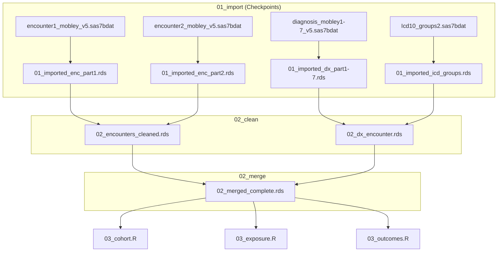

# Phase 5: Data Lineage and File Inventory - Research

**Researched:** 2026-11-02
**Domain:** SAS-to-R pipeline forensics — static code analysis, file inventory, preflight checking
**Confidence:** HIGH (all findings derived from direct source inspection of R pipeline and SAS files in the repo)

---

<user_constraints>
## User Constraints (from CONTEXT.md)

### Locked Decisions

**SAS Alias Resolution**
- D-01: Parse ALL LIBNAME, FILENAME, and `%include` statements across every SAS file in the repo — including dated/exploratory ones. Do not limit to V5 pipeline files only.
- D-02: For each alias found, record: alias name, declared path, which SAS programs use it, and whether it feeds the V5 analytical pipeline or is legacy.
- D-03: Resolve every alias from SAS LIBNAME statements first; then compare against `R/config.R` and record agreement or conflict. Do not treat any alias as confirmed until the SAS LIBNAME parse is done. `R/config.R` comments are hypotheses to verify, not ground truth.
- D-04: For the `dx` library alias, `00_check_inputs.R` must probe all candidate paths: `data_dir_raw`, `file.path(data_dir_raw, "Dx")`, `/blue/erin.mobley-precision/ResVault/f/Dx`, `/orange/erin.mobley-precision/f/Dx`, and any additional paths found in SAS LIBNAME for `dx`.
- D-05: Any additional aliases discovered during parsing get the same treatment: resolve from SAS code, compare with R config, flag "Must verify on HiPerGator" if path cannot be confirmed from code alone.

**Case-Insensitive File Name Matching**
- D-06: SAS on Linux writes dataset files in lowercase. `00_check_inputs.R` must perform case-insensitive file existence checks (list directory contents and match without case sensitivity), report actual on-disk filename alongside the R import call name, and flag discrepancies as `mismatch` status.

**Missing-in-R Table Handling**
- D-07: Two-tier severity in `00_check_inputs.R`:
  - FAIL — table imported by current R pipeline and missing or lacks expected columns. Pipeline cannot run.
  - WARN — table used in SAS but not yet imported in R. Reports FOUND/MISSING but does not block overall PASS/FAIL.
- D-08: Manifest `status` column values: `ok` / `missing_in_r` / `unused` / `mismatch` / `must_verify`.

**Mermaid Diagram Structure**
- D-09: `DATA_LINEAGE.md` contains TWO Mermaid diagrams:
  1. Phase-grouped overview: `Raw SAS files → 01_import (checkpoints) → 02_clean → 02_merge → 03_cohort → 03_exposure / 03_outcomes / 03_covariates → 04_table1 / 04_regression → Output`
  2. File-level dx/encounter diagram: dx parts + encounter parts + icd_groups2 → `02_dx_encounter` / `encounters_cleaned` → `merged_complete` → `03_*` scripts. Must reflect current R code state, not SAS original.

**Column Lineage Depth**
- D-10: Two separate outputs: `docs/column_lineage.csv` (full column map per table per column) and `DATA_LINEAGE.md` narrative (broken-pipe findings only).
- D-11: Known broken-pipe candidates to check: `first_can_ruca`, `first_can_sdi_score`, `source` column, `any_reportable_cancer`, `group_site`, `ID → patid` rename.

**00_check_inputs.R Constraints**
- D-12: Never load full tables. Use `haven::read_sas(path, n_max = 0)` directly — NOT `import_sas()`. Assert `nrow(result) == 0`; fall back to `n_max = 1` and discard data if needed.
- D-13: Output is a written report (text or CSV), not just console messages.
- D-14: Script must be runnable standalone: sources `R/config.R` only. Does not call `import_sas()` or any `utils_import.R` function.

### Claude's Discretion

- Report format for `00_check_inputs.R` output (plain text vs. CSV vs. both) — Claude decides based on what's most useful for a batch HiPerGator run.
- Whether `column_lineage.csv` includes columns from RDS checkpoint tables or only raw SAS input columns — Claude decides based on feasibility from static code analysis.
- Ordering and grouping of rows in the manifest CSV — Claude decides.

### Deferred Ideas (OUT OF SCOPE)

None — discussion stayed within phase scope.
</user_constraints>

---

## Summary

Phase 5 is a pure code-reading and documentation phase. No data is touched. All four deliverables — `DATA_LINEAGE.md`, `file_manifest.csv`, `column_lineage.csv`, and `R/00_check_inputs.R` — are produced by static analysis of the existing R pipeline and SAS source files in the repo.

The key technical challenge is correctly mapping SAS library aliases to real HiPerGator paths, identifying which tables the R pipeline currently imports versus which it defers, and producing a preflight checker that is standalone (sources only `config.R`) and reads only file headers via `haven::read_sas(path, n_max = 0)`.

The `docs/` directory does not yet exist. Wave 0 must create it. The `00_check_inputs.R` preflight checker is a new script with no existing analogue to adapt.

**Primary recommendation:** Produce deliverables in dependency order — manifest and column lineage first (static analysis), then `00_check_inputs.R` (programmatic, driven by manifest data), then `DATA_LINEAGE.md` (narrative wraps findings from all prior steps).

---

## SAS Alias Inventory (from direct LIBNAME parse)

This is the primary factual output of the SAS file scan. The planner must pass this to the implementer verbatim.

### Aliases Found in V5 Analytical Pipeline Files (`SAS_CODE_FOR_V5_*.sas`)

| Alias | Declared Path | Meaning | V5 Pipeline Files |
|-------|--------------|---------|-------------------|
| `v3`  | `&path/Data_v5` | Points to Data_v5 — the primary V5 data directory | ALL V5_*.sas files (V5_0 through V5_18, MODELS*) |
| `dx`  | `/blue/erin.mobley-precision/ResVault/f/Dx` (hardcoded) | Dx subdirectory containing Icd10_groups2 and other reference datasets | ALL V5_*.sas files |
| `v4`  | `&path/Data_v5/` (in V5_12) | **Confusing**: V5_12 uses `v4` alias pointing to Data_v5, not Data_v4 | SAS_CODE_FOR_V5_12.sas only |

**Note on `v3` vs `v4` naming confusion (confirmed by direct parse):**
- In V5 pipeline files, the alias `v3` points to `&path/Data_v5` — this is the primary V5 data directory. `R/config.R` comment "v3 → Data_v5" is CONFIRMED correct.
- `SAS_CODE_FOR_V5_12.sas` additionally declares `libname v4 "&path/Data_v5/"` — same directory, different alias name. This is an internal inconsistency in the SAS code.
- `&path` is a SAS macro variable that resolves at runtime. Based on `ins_presinvesting.sas` (which uses the concrete path `libname mobley "/orange/erin.mobley-precision/Data_v5"`), `&path` almost certainly resolves to `/orange/erin.mobley-precision` on HiPerGator (or `/blue/erin.mobley-precision` for some runs). **Cannot confirm without running the code.**

### Aliases Found in Legacy/Exploratory Files (not V5 pipeline)

| Alias | Declared Path | Files | Classification |
|-------|--------------|-------|----------------|
| `v4` (or `a`) | `/blue/erin.mobley-precision/ResVault/f/Data_v4/` | chemo_*, checks_*, sas_0*_2024, NDC_ID, HL_IDS (V4-era) | Legacy — Data_v4, not V5 |
| `v4` | `&path/ResVault/f/Data_v4/` (macro version) | intensity_8_7, for_table_1_8_7, keytodatasets, etc. | Legacy |
| `dx` | `F:\Dx` (Windows local drive) | `dx and tumor 5 30 2024.sas`, `outcomes_7_11_2024.sas` | Legacy — local drive, not HiPerGator |
| `dx` | `&path./Dx/` | `for_pdf.sas`, `sas_5_16_2024.sas`, `sas_5_17_2024.sas`, `sas_5_21_2024.sas` | Mixed-era |
| `dx` | `/blue/erin.mobley-precision/ResVault/f/Dx` (hardcoded) | `freq.sas`, `HL_IDS_1_9_2025.sas` (commented out) | Matches V5 pipeline declaration |
| `v3` | `F:\Data_v4` | `dx and tumor 5 30 2024.sas` | Legacy — local drive |
| `v3` | `&path/Data_v5` | `freq.sas`, `HL_IDS_1_9_2025.sas` | Matches V5 pipeline |
| `mobley` | `/orange/erin.mobley-precision/Data_v5` | `ins_presinvesting.sas` | Orange storage confirmation |
| `a` | `/blue/erin.mobley-precision/ResVault/f/Data_v4/` | chemo4_9_2024, sas_05_0* | Legacy alias for v4 data |
| `arm`, `arm1_2`, `ww` | Windows local paths | `dx and tumor 5 30 2024.sas` | Local drive — legacy |
| `g` | `/home/ggarvan/` | `mist.sas` | Home directory — legacy |

### Key Path Findings

**V5 data directory (`v3` alias in V5 pipeline):**
- `&path/Data_v5` — macro resolves to unknown prefix on HiPerGator
- `R/config.R` uses: `/orange/erin.mobley-precision/Data_v5` as `data_dir_raw`
- `ins_presinvesting.sas` hardcodes: `/orange/erin.mobley-precision/Data_v5` (alias `mobley`)
- **Conclusion:** `data_dir_raw = /orange/erin.mobley-precision/Data_v5` is confirmed as the V5 data path. HIGH confidence.

**`dx` alias in V5 pipeline:**
- ALL V5 pipeline files hardcode: `libname dx "/blue/erin.mobley-precision/ResVault/f/Dx"`
- `R/config.R` does NOT define a path for the `dx` library — `01_import.R` uses a fallback: tries `data_dir_raw` first, then `file.path(data_dir_raw, "Dx")`
- The actual SAS declaration uses `/blue/...` not `/orange/...`
- **Conclusion:** `00_check_inputs.R` must probe all four candidates per D-04. The hardcoded SAS path `/blue/erin.mobley-precision/ResVault/f/Dx` is the canonical SAS declaration.

**V4 data directory:**
- `/blue/erin.mobley-precision/ResVault/f/Data_v4/` — confirmed from multiple hardcoded references
- V4 data is NOT imported by the current R pipeline. Legacy only.

---

## Complete File Inventory (for manifest construction)

### Tables Currently Imported by R Pipeline

The implementer must produce one manifest row per table. This section enumerates every table the R pipeline imports:

| R Import Call | SAS Filename | Alias | Description | Import Method | RDS Checkpoint | KEEP_* vector |
|---------------|-------------|-------|-------------|---------------|----------------|---------------|
| `import_and_save` | `demographic_mobley_v5.sas7bdat` | v3 | Patient demographics | Full | `01_imported_demo.rds` | NULL (all cols) |
| `import_and_save` | `enrollment_mobley_v5.sas7bdat` | v3 | Patient enrollment | Full | `01_imported_enroll.rds` | NULL |
| `import_and_save` | `address_history_mobley_v5.sas7bdat` | v3 | Address history | Full | `01_imported_address.rds` | NULL |
| `import_parts` | `diagnosis_mobley1_v5.sas7bdat` through `diagnosis_mobley7_v5.sas7bdat` | v3 | Diagnosis (7 parts) | Parts | `01_imported_dx_part1.rds` … `part7.rds` | KEEP_DX |
| `import_and_save` | `provider_mobley_v5.sas7bdat` | v3 | Provider data | Full | `01_imported_provider.rds` | NULL |
| `import_and_save` | `zcta.sas7bdat` | v3 | ZCTA geographic ref | Full | `01_imported_zcta.rds` | NULL |
| `import_and_save` | `dispensing_mobley_v5.sas7bdat` | v3 | Dispensing/prescriptions | Full | `01_imported_dispensing.rds` | KEEP_DISP |
| `import_parts` | `procedures_mobley1_v5.sas7bdat`, `procedures_mobley2_v5.sas7bdat`, `procedures_mobley3_v5.sas7bdat`, `procedures4_mobley_v5.sas7bdat` | v3 | Procedures (4 parts, naming inconsistency on part 4) | Parts | `01_imported_proc_part1.rds` … `part4.rds` | KEEP_PROC |
| `import_parts` | `encounter1_mobley_v5.sas7bdat`, `encounter2_mobley_v5.sas7bdat` | v3 | Encounter (2 parts) | Parts | `01_imported_enc_part1.rds`, `01_imported_enc_part2.rds` | KEEP_ENC |
| `import_sas` (direct) | `Icd10_groups2.sas7bdat` | dx | ICD-10 cancer site mapping | Full | `01_imported_icd_groups.rds` | NULL — dual-path fallback |

**Total: 17 SAS source files → 13 named checkpoints (9 single, 4 groups of parts)**

### Tables Referenced in SAS but NOT Imported by Current R Pipeline (WARN tier)

| SAS Table | SAS Alias | Used In SAS File | Deferred In R | Deferral Location |
|-----------|----------|-----------------|---------------|-------------------|
| `ndc_cond2` (SEERRxCategory) | dx | V5_12 (chemo identification) | NDC chemo deferred | `03_exposure.R` ~line 86, `02_clean.R` ~line 266 |
| `surgerycodes` | dx | V5_12 (surgery identification) | Surgery uses PCS best-effort | `02_clean.R` ~line 266-268 |
| `sctcodes` | dx (presumed) | SAS V5_12 | Not imported | Not mentioned in R comments |
| `prov_spec` / `provider_mobley_v5` | v3 | V5 pipeline | Absorbed into provider table | `02_merge.R` ~line 127 note |
| `ruca` (standalone) | v3 | SAS — RUCA linkage | `zcta.sas7bdat` used instead | `01_import.R` GROUP 4 comment |

### SAS Files NOT Imported by R Pipeline (legacy — must classify in manifest)

- ALL `SAS_CODE_FOR_V4_*.sas` and `SAS_CODE_V4_*.sas` — V4 pipeline, not imported
- All dated exploratory files (`SAS_PROGRAM_3_*`, `chemo_*`, `checks_*`, `sas_0*_2024`, etc.) — legacy/exploratory
- `Formats.sas` — translated to `R/01_formats.R` and `01_formats.rds`; the `.sas` file itself is not imported

---

## Column-Level Broken Pipe Candidates (from D-11)

The implementer must trace each of these through the R pipeline:

| Column | Origin Script | Consumed In | Issue |
|--------|--------------|-------------|-------|
| `first_can_ruca` | Unknown — must trace | `03_covariates.R` line ~171 (`first_ruca = first_can_ruca`) | May not be produced upstream; verify in `03_cohort.R` or `02_merge.R` |
| `first_can_sdi_score` | Unknown — must trace | `03_covariates.R` line ~148 (`first_sdi = first_can_sdi_score`) | Same issue |
| `source` (column from KEEP_ENC) | `01_import.R` KEEP_ENC vector | `02_clean.R` and downstream | Column is kept but may be renamed or collide with other tables |
| `any_reportable_cancer` | `02_clean.R` (derived in dx part loop) | `03_cohort.R`, `03_outcomes.R` | Check whether still available in `02_merged_complete.rds` → `03_cohort.R` reads `dx_encounter.rds` which carries it |
| `group_site` | `02_clean.R` (via `apply_icd_overrides`) | `03_exposure.R` — reads from `02_merged_complete.rds` | `02_merge.R` header comment confirms `group_site` flows into `merged_complete` from `dx_encounter`; likely OK, but must verify |
| `ID → patid` rename | `utils_import.R` line 61 | All downstream scripts | Rename happens in `import_sas()` via `clean_names()` then explicit rename. Any script reading `ID` after import will fail. All R scripts use `patid`. Check SAS files still use `ID`. |

**Known column lineage for `first_can_ruca` / `first_can_sdi_score`:** These columns are produced in `03_cohort.R` (where first cancer encounter is identified and covariates are attached from `address` table). Must confirm by reading `03_cohort.R` fully. If the column exists in the `zcta.sas7bdat` join output and is selected, it flows to `03_covariates.R`. If it is dropped from a KEEP vector or not joined, it is a broken pipe.

---

## Architecture Patterns

### Recommended Deliverable Production Order

1. **Wave 0:** Create `docs/` directory; write empty manifest/lineage CSV headers; write skeleton `00_check_inputs.R` sourcing `config.R`.
2. **Wave 1:** Static analysis → populate `docs/file_manifest.csv` (one row per SAS table) and `docs/column_lineage.csv` (one row per column per table) by reading R scripts.
3. **Wave 2:** Implement `00_check_inputs.R` preflight logic driven by the manifest content.
4. **Wave 3:** Write `docs/DATA_LINEAGE.md` — narrative + two Mermaid diagrams — synthesizing findings from all prior waves.

### 00_check_inputs.R Design

```r
# R/00_check_inputs.R
# Standalone preflight checker — sources only config.R

library(here)
source(here::here("R", "config.R"))
library(haven)

# For each entry in the manifest:
#   1. Check file existence (case-insensitive directory listing)
#   2. Read header only: haven::read_sas(path, n_max = 0)
#   3. Assert nrow == 0; if not, warn and discard
#   4. Compare colnames to expected columns
#   5. Assign status: ok / missing_in_r / mismatch / must_verify / fail / warn
#   6. Write report to output file (not just console)

# Case-insensitive file existence check pattern:
check_file_ci <- function(dir_path, filename) {
  if (!dir.exists(dir_path)) return(list(found = FALSE, disk_name = NA_character_))
  files_on_disk <- list.files(dir_path)
  match_idx <- which(tolower(files_on_disk) == tolower(filename))
  if (length(match_idx) == 0) return(list(found = FALSE, disk_name = NA_character_))
  list(found = TRUE, disk_name = files_on_disk[match_idx[1]])
}

# Probe multiple candidate paths for dx alias (D-04):
dx_candidates <- c(
  data_dir_raw,
  file.path(data_dir_raw, "Dx"),
  "/blue/erin.mobley-precision/ResVault/f/Dx",
  "/orange/erin.mobley-precision/f/Dx"
)
```

**Output format decision (Claude's discretion):** Produce BOTH:
- `output/preflight_report.txt` — human-readable summary for batch review (grep-friendly PASS/FAIL/WARN lines)
- `output/preflight_report.csv` — machine-readable (table, path_probed, status, disk_name, r_import_name, notes)

Two formats because HiPerGator batch runs capture stdout, and the CSV is useful for downstream tooling. The `.txt` is easier to scan for failures at a glance.

### Column Lineage CSV Design (Claude's discretion)

Include columns from **raw SAS inputs only** (not RDS checkpoints). Reason: RDS checkpoints are derived transformations of the raw inputs, and adding them would double the row count with marginal new information for the stated goal (account for SAS input files and how they flow). Checkpoint-to-checkpoint flows are documented in the Mermaid diagram instead.

```
table, column, origin, created_in, consumed_by
demo, patid, raw (renamed from ID), 01_import.R, 03_cohort.R|02_merge.R|...
demo, birth_date, raw, 01_import.R, 03_cohort.R
...
```

`origin` values: `raw` (direct from SAS file), `renamed` (clean_names or explicit rename), `derived` (mutate/case_when in R).

### Manifest CSV Column Order (Claude's discretion)

Group rows by pipeline phase, then alphabetically within group:

```
alias, sas_filename, hipergator_path, r_import_call, r_checkpoint_rds,
columns_kept, downstream_consumers, status, r_import_name, disk_name, notes
```

Within the file: V5 pipeline tables first (import order), then WARN-tier missing-in-R tables, then legacy/unused.

### Mermaid Diagram — dx/encounter File-Level (current R code state)



---

## Don't Hand-Roll

| Problem | Don't Build | Use Instead | Why |
|---------|-------------|-------------|-----|
| SAS file header reading | Custom binary parser | `haven::read_sas(path, n_max = 0)` | haven handles SAS7BDAT format correctly; n_max=0 reads only metadata |
| Case-insensitive file check on Linux | `file.exists()` alone | `list.files()` + `tolower()` comparison | Linux filesystems are case-sensitive; `file.exists("Icd10_groups2.sas7bdat")` returns FALSE if disk has `icd10_groups2.sas7bdat` |
| Mermaid diagrams | Custom graph renderer | Mermaid code blocks in Markdown | GitHub, most docs platforms render Mermaid natively; no tooling needed |
| CSV output | Custom format | `write.csv()` or `readr::write_csv()` | Standard; the manifest and column lineage are static documents, not processed further |

---

## Common Pitfalls

### Pitfall 1: `haven::read_sas(path, n_max = 0)` may not return 0 rows in older haven
**What goes wrong:** Older haven versions (< 2.4.0) ignore `n_max = 0` and read all rows.
**How to avoid:** D-12 mandates: assert `nrow(result) == 0` after the call; if assertion fails, fall back to `n_max = 1` and discard. Log which fallback was triggered.
**Warning signs:** Script runs slowly on HiPerGator for large tables (diagnosis, procedures).

### Pitfall 2: `file.exists()` case sensitivity on Linux
**What goes wrong:** `Icd10_groups2.sas7bdat` on disk may actually be `icd10_groups2.sas7bdat`. `file.exists("Icd10_groups2.sas7bdat")` returns FALSE even though the file exists. This is the exact bug D-06 addresses.
**How to avoid:** Always use `list.files(dir)` + `tolower()` comparison pattern shown above. Never use `file.exists()` alone for SAS file checks in `00_check_inputs.R`.
**Warning signs:** `import_sas()` returns NULL for a file you believe is present.

### Pitfall 3: Mermaid diagram reflects SAS original rather than current R code
**What goes wrong:** D-09 explicitly requires the dx/encounter diagram to reflect the current R code state, not the SAS original. The R pipeline has undergone OOM rewrites (dx_combined → dx_encounter, merged_enc_dx → merged_complete). Drawing the SAS-era flow would misrepresent what the code actually does.
**How to avoid:** Base diagrams entirely on reading the R pipeline files, not the SAS files. The SAS diagrams are mentioned only in the phase-grouped overview as "Raw SAS files" node.
**Warning signs:** Diagram references `02_dx_combined.rds` or `02_merged_enc_dx.rds` — both are removed outputs per `02_clean.R` header comments.

### Pitfall 4: `00_check_inputs.R` sourcing `utils_import.R`
**What goes wrong:** D-14 explicitly forbids calling `import_sas()` or any `utils_import.R` function. The preflight checker must be standalone. If `import_sas()` is used, it performs cleaning steps and lacks `n_max` — it would read full files.
**How to avoid:** Call `haven::read_sas()` directly. Only source `R/config.R`.

### Pitfall 5: `source` column collision
**What goes wrong:** `KEEP_ENC` includes a `SOURCE` column from the encounter table. After `clean_names()`, this becomes `source`. This is a common English word that could collide with R's `source()` function or produce confusing variable names downstream.
**How to avoid:** Document this in the column lineage as a notable rename. Flag in manifest notes.

### Pitfall 6: `&path` macro variable is unresolvable from code alone
**What goes wrong:** Most SAS LIBNAME declarations use `&path/Data_v5` rather than a hardcoded path. The value of `&path` is set elsewhere (likely in a site config or batch submission header not in the repo). Cannot determine this value from static analysis.
**How to avoid:** For manifest rows affected by `&path`, set `status = must_verify` and note the alias cannot be confirmed without running on HiPerGator. `ins_presinvesting.sas` provides the concrete path (`/orange/erin.mobley-precision/Data_v5`) as a HIGH-confidence cross-reference.

---

## Validation Architecture

nyquist_validation is enabled (not set to false in config.json).

### Test Framework
| Property | Value |
|----------|-------|
| Framework | testthat (established in Phases 1-4) |
| Config file | `tests/testthat.R` (exists from prior phases) |
| Quick run command | `Rscript -e "testthat::test_dir('tests/testthat', filter='check_inputs')"` |
| Full suite command | `Rscript -e "testthat::test_dir('tests/testthat')"` |

### Phase Requirements → Test Map

Phase 5 has no formal requirements in REQUIREMENTS.md (added after v1). Deliverables are documentation + one R script. Testing strategy:

| Deliverable | Test Type | Automated Command | Notes |
|-------------|-----------|-------------------|-------|
| `00_check_inputs.R` — case-insensitive match logic | unit | `testthat::test_file('tests/testthat/test_check_inputs.R')` | Test `check_file_ci()` helper with mock dir listings |
| `00_check_inputs.R` — n_max=0 assertion | unit | Same file | Test that 0-row result is asserted correctly |
| `00_check_inputs.R` — severity tier logic (FAIL vs WARN) | unit | Same file | Test both tiers with mock manifest entries |
| `docs/file_manifest.csv` — file exists, correct columns | static | `Rscript -e "stopifnot(file.exists('docs/file_manifest.csv'))"` | File existence check only |
| `docs/column_lineage.csv` — file exists | static | Same pattern | File existence check only |
| `docs/DATA_LINEAGE.md` — file exists, git hash present | static | `grep -c "commit" docs/DATA_LINEAGE.md` | Narrative content not unit-testable |

### Wave 0 Gaps
- [ ] `tests/testthat/test_check_inputs.R` — test file for `00_check_inputs.R` helper functions
- [ ] `docs/` directory — does not exist yet (create in Wave 0)

---

## Environment Availability

| Dependency | Required By | Available | Version | Fallback |
|------------|------------|-----------|---------|----------|
| `haven` R package | `00_check_inputs.R` (read_sas n_max=0) | Yes — used throughout pipeline | 2.5.5 per CLAUDE.md | None — required |
| `here` R package | `00_check_inputs.R` (config.R sourcing) | Yes — used throughout pipeline | 1.0.2 | None — required |
| HiPerGator filesystem | `00_check_inputs.R` execution | Not available locally | n/a | Script writes "MUST VERIFY" for all path probes when dirs don't exist — graceful degradation |
| `docs/` directory | All four deliverables | Does not exist | — | Create in Wave 0 |

**Missing dependencies with no fallback:** None (script degrades gracefully when HiPerGator paths are unavailable).

**Note on local execution:** `00_check_inputs.R` will produce WARN or MUST_VERIFY output for all HiPerGator paths when run locally. This is expected behavior — the script is designed for HiPerGator execution but should not crash locally.

---

## Project Constraints (from CLAUDE.md)

- Language: R with tidyverse. `00_check_inputs.R` uses `haven` and `here` only (no tidyverse needed in preflight).
- No data access: code written without running against data. `00_check_inputs.R` reads headers only (`n_max = 0`).
- File paths parameterized via `R/config.R` with `here::here()`.
- SAS7BDAT input: `haven::read_sas()` is the only approved importer.
- `docs/` directory: Must be created as part of this phase (does not yet exist).
- The `docs/` and `R/00_check_inputs.R` paths are new — no existing scripts or directories to conflict with.

---

## Sources

### Primary (HIGH confidence)
- Direct read of `R/config.R` — path variables, PIPELINE_TEST switch
- Direct read of `R/01_import.R` — all import calls, KEEP_* vectors, dual-path icd fallback
- Direct read of `R/utils_import.R` — import_sas(), import_parts(), import_and_save() signatures
- Direct read of `R/02_clean.R` — surgerycodes/ndc_cond2 deferral, dx part processing, checkpoint outputs
- Direct read of `R/02_merge.R` — inputs and outputs, prov_spec absorption note
- Direct read of `R/03_cohort.R` — checkpoint inputs including `02_merged_complete.rds`
- Direct read of `R/03_exposure.R` — group_site usage, ndc_cond2 deferral
- Direct read of `R/03_covariates.R` — `first_can_ruca`, `first_can_sdi_score` usage
- Grep of all `*.sas` files for LIBNAME statements — alias inventory above

### Secondary (MEDIUM confidence)
- CLAUDE.md technology stack — haven version, here version
- 05-CONTEXT.md decisions — locked decisions D-01 through D-14

---

## Metadata

**Confidence breakdown:**
- SAS alias inventory: HIGH — derived from direct grep of all ~126 SAS files
- R pipeline file inventory: HIGH — derived from direct read of all R pipeline scripts
- Broken pipe candidates: MEDIUM — static analysis can identify read/write points but cannot confirm column presence in RDS files without running the code
- `00_check_inputs.R` design: HIGH — all constraints are explicitly locked in CONTEXT.md decisions

**Research date:** 2026-11-02
**Valid until:** Until memory-fix work changes the R pipeline (per CONTEXT.md: this phase must record git commit hash because the memory-fix work will change the code afterward)
