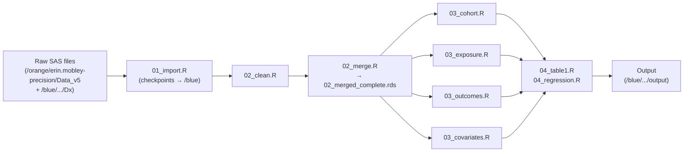
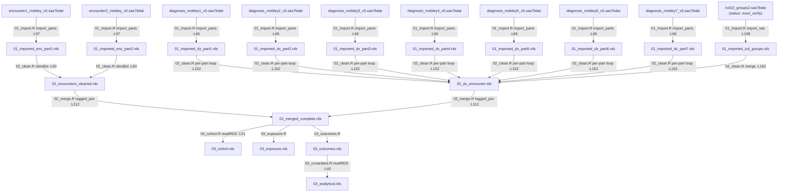

# Data Lineage — Precision Cancer Survivorship Insurance Investigation

**Generated from commit:** aefabd752f2873c04b604815e23dd4ee429f612b
**Date:** 2026-11-02
**Git status at generation:**
```
?? (many untracked SAS/legacy files — all unrelated to the R pipeline)
```
Only untracked files are present; no modified tracked files. The untracked SAS files are the original
SAS source code under investigation — they are not consumed by the R pipeline directly.

---

## Overview

The pipeline imports PCORnet CDM SAS7BDAT files from two server directories on HiPerGator
(`data_dir_raw` on `/orange/erin.mobley-precision/Data_v5` for cohort data; a secondary `Dx/`
subdirectory for the ICD code reference file), processes them through data-cleaning and merging
steps that produce RDS checkpoints on `/blue/erin.mobley-precision/...` (`data_dir_processed`),
and then constructs an analytical dataset through four Phase 3 scripts. This document is produced
by static analysis of the R pipeline scripts only — no data was read.

---

## Diagram 1: Phase-grouped pipeline overview



---

## Diagram 2: File-level dx/encounter flow (current R code state)

Line citations in edge labels reference the exact call-site in the R script.



---

## File Inventory Summary

Full details are in `docs/file_manifest.csv` (one row per physical SAS file, plus WARN-tier and
legacy summary rows). Notable items:

- **20 physical SAS files** imported by the R pipeline across 8 import groups (GROUP 1–7 plus GROUP 6b).
- **`Icd10_groups2.sas7bdat`** (`manifest_status = must_verify`): R imports using the name
  `Icd10_groups2.sas7bdat`, but SAS on Linux commonly writes filenames in lowercase. The actual
  disk name may be `icd10_groups2.sas7bdat`. `R/00_check_inputs.R` probes four candidate paths at
  runtime and reports the actual disk filename.
- **`procedures4_mobley_v5.sas7bdat`** (GROUP 6, part 4): naming inconsistency vs. parts 1–3
  (which follow the `procedures_mobleyN_v5` pattern). Flagged at `R/01_import.R:L84`.
- **WARN-tier — referenced in SAS but not yet imported in R**: `ndc_cond2.sas7bdat`
  (SEERRxCategory for chemo identification — deferred at `03_exposure.R`),
  `surgerycodes.sas7bdat` (surgery identification — best-effort ICD-10-PCS used instead),
  `sctcodes.sas7bdat` (referenced in SAS V5_12; no R deferral comment found).
- **`address_history_mobley_v5.sas7bdat`** and **`zcta.sas7bdat`**: imported to RDS checkpoints
  (`01_imported_address.rds`, `01_imported_zcta.rds`) but **no downstream script reads either
  checkpoint** — confirmed broken pipes.

---

## Broken-Pipe Findings

### Renames

- **`ID → patid`**: `utils_import.R:L61` — `clean_names()` lowercases `ID` to `id`, then the
  explicit rename `names(df)[names(df) == "id"] <- "patid"` runs on every `import_sas()` call.
  All downstream scripts use `patid`. Status: **confirmed OK** (rename is universal at import).

- **`first_can_ruca → first_ruca`**: `03_covariates.R:L171` —
  `mutate(first_ruca = first_can_ruca)`. This is a rename/alias for model variable naming.
  `first_can_ruca` must exist in `03_outcomes.rds` for this to succeed at runtime.

- **`first_can_sdi_score → first_sdi`**: `03_covariates.R:L148` —
  `mutate(first_sdi = first_can_sdi_score, ...)`. Same pattern.

### Columns consumed but never produced (confirmed broken pipes)

- **`first_can_ruca`**: consumed at `03_covariates.R:L171`. Traced through all R scripts — no
  script produces this column. `zcta.sas7bdat` is imported (`01_import.R:L76`) but its RDS
  (`01_imported_zcta.rds`) is never read by any downstream script. The ZCTA→RUCA linkage join
  that would produce `first_can_ruca` was never translated from SAS to R.
  Status: **confirmed broken pipe**. The pipeline will error at `03_covariates.R:L171` unless
  `first_can_ruca` is added to `03_cohort.R` or `03_outcomes.R`.

- **`first_can_sdi_score`**: consumed at `03_covariates.R:L148`. Same root cause — the
  ZCTA→SDI linkage join that would produce this column does not exist in any R script.
  Status: **confirmed broken pipe**.

### Files imported but checkpoint never consumed

- **`address_history_mobley_v5.sas7bdat`** → `01_imported_address.rds` (`01_import.R:L60`):
  no downstream script calls `readRDS(...01_imported_address...)`.
  Status: **confirmed broken pipe** — imported but unused.

- **`zcta.sas7bdat`** → `01_imported_zcta.rds` (`01_import.R:L76`): no downstream script reads
  this checkpoint. Status: **confirmed broken pipe** — the root cause of both
  `first_can_ruca` and `first_can_sdi_score` being missing.

### Potential collision points

- **`SOURCE → source`**: `KEEP_ENC` at `01_import.R:L46` includes `"SOURCE"`. After
  `clean_names()` in `utils_import.R:L59`, this becomes `source`. R's built-in `source()`
  function has the same name. The column compiles fine as a data frame field, but referencing it
  unquoted in certain contexts (e.g. `with(df, source(...))`) could call the base function
  instead. Status: **suspected** (compiles, may cause confusion; label carefully in downstream code).

### Columns confirmed to flow correctly

- **`any_reportable_cancer`**: produced at `02_clean.R:L170` (`part[, any_reportable_cancer := ...]`)
  inside the per-part dx loop, aggregated to `02_dx_encounter.rds` at `02_clean.R:L227`, and
  carried through `02_merged_complete.rds` via the one-to-one join at `02_merge.R:L112`.
  Consumed by `03_cohort.R`. Status: **confirmed OK**.

- **`group_site`**: produced at `02_clean.R:L116` (`apply_icd_overrides`) and at `02_clean.R:L162`
  (icd_groups merge), aggregated into `02_dx_encounter.rds` at `02_clean.R:L227`, and carried
  through `02_merged_complete.rds`. Status: **confirmed OK** (flows through merge).

- **`patid`**: produced universally by `utils_import.R:L61` rename on every import.
  Status: **confirmed OK**.

---

## Must Verify on HiPerGator

These items require runtime verification on HiPerGator because they cannot be confirmed from
static code analysis alone. `R/00_check_inputs.R` generates `output/preflight_report.txt`
with a `=== MUST VERIFY ON HIPERGATOR ===` section that mirrors this list at runtime.

- **All v3-alias tables** (GROUP 1–6b, 17 files at `/orange/erin.mobley-precision/Data_v5`):
  path confirmed from `ins_presinvesting.sas` hardcoded `&path` macro resolution; must verify
  files exist at that path on HiPerGator before running `01_import.R`.

- **`Icd10_groups2.sas7bdat`** (GROUP 7, `dx` alias): run `R/00_check_inputs.R` on HiPerGator.
  It probes four candidate paths and reports which exist and the actual disk filename. The
  case-mismatch risk is real: SAS on Linux writes lowercase filenames, but R imports using
  `"Icd10_groups2.sas7bdat"`. A case-only mismatch is classified as `FAIL` by the checker.

- **`ndc_cond2.sas7bdat`, `surgerycodes.sas7bdat`, `sctcodes.sas7bdat`** (WARN-tier): pipeline
  runs without them but chemo/surgery identification will be incomplete. Deferral is intentional
  for the current R translation; these files should be located and imported in a future phase.

- **Cross-reference**: `docs/column_lineage.csv` documents the `first_can_ruca` and
  `first_can_sdi_score` broken-pipe status. These must be resolved before the pipeline can
  produce a complete `03_analytical.rds`.
