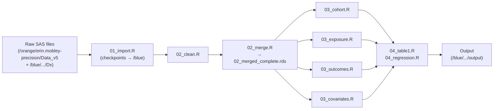
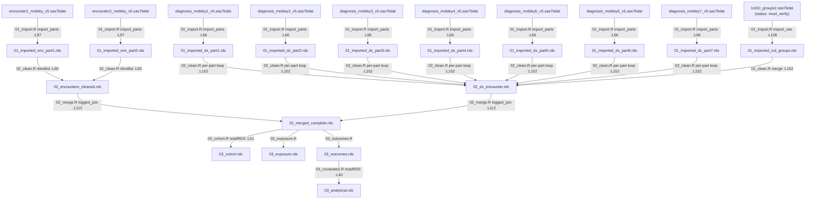

# Data Lineage — Precision Cancer Survivorship Insurance Investigation

**Generated from commit:** aefabd752f2873c04b604815e23dd4ee429f612b
**Date:** 2026-11-02
**Git status at generation:**
```
?? (many untracked SAS/legacy files — all unrelated to the R pipeline)
```
Only untracked files are present; no modified tracked files. The untracked SAS files are the original
SAS source code under investigation — they are not consumed by the R pipeline directly.

---

## Overview

The pipeline imports PCORnet CDM SAS7BDAT files from two server directories on HiPerGator
(`data_dir_raw` on `/orange/erin.mobley-precision/Data_v5` for cohort data; a secondary `Dx/`
subdirectory for the ICD code reference file), processes them through data-cleaning and merging
steps that produce RDS checkpoints on `/blue/erin.mobley-precision/...` (`data_dir_processed`),
and then constructs an analytical dataset through four Phase 3 scripts. This document is produced
by static analysis of the R pipeline scripts only — no data was read.

---

## Diagram 1: Phase-grouped pipeline overview



---

## Diagram 2: File-level dx/encounter flow (current R code state)

Line citations in edge labels reference the exact call-site in the R script.



---

## File Inventory Summary

Full details are in `docs/file_manifest.csv` (one row per physical SAS file, plus WARN-tier and
legacy summary rows). Notable items:

- **20 physical SAS files** imported by the R pipeline across 8 import groups (GROUP 1–7 plus GROUP 6b).
- **`Icd10_groups2.sas7bdat`** (`manifest_status = must_verify`): R imports using the name
  `Icd10_groups2.sas7bdat`, but SAS on Linux commonly writes filenames in lowercase. The actual
  disk name may be `icd10_groups2.sas7bdat`. `R/00_check_inputs.R` probes four candidate paths at
  runtime and reports the actual disk filename.
- **`procedures4_mobley_v5.sas7bdat`** (GROUP 6, part 4): naming inconsistency vs. parts 1–3
  (which follow the `procedures_mobleyN_v5` pattern). Flagged at `R/01_import.R:L84`.
- **WARN-tier — referenced in SAS but not yet imported in R**: `ndc_cond2.sas7bdat`
  (SEERRxCategory for chemo identification — deferred at `03_exposure.R`),
  `surgerycodes.sas7bdat` (surgery identification — best-effort ICD-10-PCS used instead),
  `sctcodes.sas7bdat` (referenced in SAS V5_12; no R deferral comment found).
- **`address_history_mobley_v5.sas7bdat`** and **`zcta.sas7bdat`**: imported to RDS checkpoints
  (`01_imported_address.rds`, `01_imported_zcta.rds`) but **no downstream script reads either
  checkpoint** — confirmed broken pipes.

---

## Broken-Pipe Findings

### Renames

- **`ID → patid`**: `utils_import.R:L61` — `clean_names()` lowercases `ID` to `id`, then the
  explicit rename `names(df)[names(df) == "id"] <- "patid"` runs on every `import_sas()` call.
  All downstream scripts use `patid`. Status: **confirmed OK** (rename is universal at import).

- **`first_can_ruca → first_ruca`**: `03_covariates.R:L171` —
  `mutate(first_ruca = first_can_ruca)`. This is a rename/alias for model variable naming.
  `first_can_ruca` must exist in `03_outcomes.rds` for this to succeed at runtime.

- **`first_can_sdi_score → first_sdi`**: `03_covariates.R:L148` —
  `mutate(first_sdi = first_can_sdi_score, ...)`. Same pattern.

### Columns consumed but never produced (confirmed broken pipes)

- **`first_can_ruca`**: consumed at `03_covariates.R:L171`. Traced through all R scripts — no
  script produces this column. `zcta.sas7bdat` is imported (`01_import.R:L76`) but its RDS
  (`01_imported_zcta.rds`) is never read by any downstream script. The ZCTA→RUCA linkage join
  that would produce `first_can_ruca` was never translated from SAS to R.
  Status: **confirmed broken pipe**. The pipeline will error at `03_covariates.R:L171` unless
  `first_can_ruca` is added to `03_cohort.R` or `03_outcomes.R`.

- **`first_can_sdi_score`**: consumed at `03_covariates.R:L148`. Same root cause — the
  ZCTA→SDI linkage join that would produce this column does not exist in any R script.
  Status: **confirmed broken pipe**.

### Files imported but checkpoint never consumed

- **`address_history_mobley_v5.sas7bdat`** → `01_imported_address.rds` (`01_import.R:L60`):
  no downstream script calls `readRDS(...01_imported_address...)`.
  Status: **confirmed broken pipe** — imported but unused.

- **`zcta.sas7bdat`** → `01_imported_zcta.rds` (`01_import.R:L76`): no downstream script reads
  this checkpoint. Status: **confirmed broken pipe** — the root cause of both
  `first_can_ruca` and `first_can_sdi_score` being missing.

### Potential collision points

- **`SOURCE → source`**: `KEEP_ENC` at `01_import.R:L46` includes `"SOURCE"`. After
  `clean_names()` in `utils_import.R:L59`, this becomes `source`. R's built-in `source()`
  function has the same name. The column compiles fine as a data frame field, but referencing it
  unquoted in certain contexts (e.g. `with(df, source(...))`) could call the base function
  instead. Status: **suspected** (compiles, may cause confusion; label carefully in downstream code).

### Columns confirmed to flow correctly

- **`any_reportable_cancer`**: produced at `02_clean.R:L170` (`part[, any_reportable_cancer := ...]`)
  inside the per-part dx loop, aggregated to `02_dx_encounter.rds` at `02_clean.R:L227`, and
  carried through `02_merged_complete.rds` via the one-to-one join at `02_merge.R:L112`.
  Consumed by `03_cohort.R`. Status: **confirmed OK**.

- **`group_site`**: produced at `02_clean.R:L116` (`apply_icd_overrides`) and at `02_clean.R:L162`
  (icd_groups merge), aggregated into `02_dx_encounter.rds` at `02_clean.R:L227`, and carried
  through `02_merged_complete.rds`. Status: **confirmed OK** (flows through merge).

- **`patid`**: produced universally by `utils_import.R:L61` rename on every import.
  Status: **confirmed OK**.

---

---

## HiPerGator SAS Dataset Audit (2026-11-02) — REVISED

Facts provided from aggregate inspection of live HiPerGator data (no patient-level data shared):

- `baseline.sas7bdat`: 507,742 rows, one per ID. Columns: ID, ENCOUNTERID, Group_Site,
  Group_detailed_site, Group_primary_disease_site, SOURCE_DEMO, SOURCE_DX, age2,
  days_START_ADMIT, first_can_hispanicc, first_can_payer_type_primary, first_can_racee,
  first_can_ruca (0/1, no missing), first_can_sdi_score (1–100, no missing), first_can_sexx (F/M).
  Group_Site is blank for 358,263 rows (~70.6%).
- `change_outcome1.sas7bdat`: 487,857 distinct IDs; median 1 row per ID;
  ~10.5k IDs not present in baseline.
- `change_outcome2.sas7bdat`: 450,691 distinct IDs.
- `change_outcome3.sas7bdat`: 218,181 distinct IDs.
- `change_outcome4.sas7bdat`: 24,254 distinct IDs.
- `change_outcome1_min..4_min.sas7bdat`: same ID+ENCOUNTERID-only structure; counts match
  the non-min tables. Likely a KEEP= subset of the corresponding change_outcome table.

---

### Task 1 — SAS source for `baseline` and `change_outcome*`

#### `baseline.sas7bdat`

No SAS DATA step writes to a dataset explicitly named `baseline`. The file on HiPerGator almost
certainly corresponds to `v3.first_can_RUCA_ztca_sdi_inss_` after the rename step in
`SAS_CODE_FOR_V5_6.sas` lines 11–44, or to `v3.dx_base_comp` (V5_6.sas lines 46–83), possibly
saved under the name `baseline` at a later ad-hoc step. Its column set matches exactly:

```
SAS_CODE_FOR_V5_6.sas:11   data v3.first_can_RUCA_ztca_sdi_inss_ (keep=ID age2
                              first_admit_date first_can_ENCOUNTERID first_can_hispanicc
                              first_can_racee first_can_sexx payer_type_primary2 ruca3 sdi_score);
SAS_CODE_FOR_V5_6.sas:41   data v3.first_can_RUCA_ztca_sdi_inss_ (rename=(ruca3=first_can_ruca
                              sdi_score=first_can_sdi_score
                              payer_type_primary2=first_can_payer_type_primary));
SAS_CODE_FOR_V5_6.sas:46   proc sql; create table v3.dx_base_comp as
                              select a.ID, a.age2, a.first_can_*, b.Group_Site,
                              b.Group_detailed_site, b.Group_primary_disease_site,
                              b.SOURCE_DEMO, b.SOURCE_DX, ...
                              from v3.first_can_RUCA_ztca_sdi_inss_ a
                              left join v3.demo_validEnroll_dx_1_ b on a.id=b.id;
```

**Exclusions that produce the 507,742 cohort (in SAS pipeline order):**

1. `SAS_CODE_FOR_V5_2.sas`: patients with valid enrollment records only (`valid_id = 1`).
2. `SAS_CODE_FOR_V5_3.sas` / `V5_4.sas`: inner join to ICD10 cancer diagnosis — keeps only
   patients with ≥1 reportable cancer code (`any_reportable_cancer = 1`).
3. `SAS_CODE_FOR_V5_4.sas`: age2 < 0 or missing age2 deleted (V5_4.sas, implicit via age calc).
4. `SAS_CODE_FOR_V5_5 (1).sas` lines 223–392: RUCA/SDI linkage — patients without a ZIP code
   within 30 days of first cancer dx are retained in a "no-RUCA" stratum; those with missing
   sdi_score are deleted (`V5_5.sas line 383: if sdi_score=. then delete`).
5. `SAS_CODE_FOR_V5_6.sas line 38`: `if first_can_sexx = "UN" then delete;` — sex-unknown
   patients excluded. This is the only explicit demographic exclusion in V5.

#### `change_outcome1..4`

Source: `SAS_CODE_FOR_v5_10.sas` (entire file, lines 1–239).

Each table captures the **last encounter** for a specific outcome type, from the corresponding
`v3.v1_outcome1..4` tables (built in `SAS_CODE_FOR_V5_9.sas` from `v3.followups_dx`):

| Table | Outcome flag | Source |
|-------|-------------|--------|
| `change_out1` | `Enc_nonacute_care = 1` (non-acute care encounter) | `v3.v1_outcome1` |
| `change_out2` | `Cancer_related_visit = 1` | `v3.v1_outcome2` |
| `change_out3` | `cancer_visit_and_prov = 1` (cancer visit + oncology provider) | `v3.v1_outcome3` |
| `change_out4` | `Survivorship_visit = 1` | `v3.v1_outcome4` |

**Algorithm for each (illustrated for change_out1):**

```sas
/* SAS_CODE_FOR_v5_10.sas lines 20-57 */
/* Part 1: IDs that ever had the outcome — take the LAST such encounter */
data change_out1_1; set change_out1;
  if enc_nonacute_care = 1;         /* line 21: filter to outcome encounters */
run;
proc sort data=change_out1_1; by ID descending ADMIT_DATE; run;  /* lines 25-26 */
proc sort data=change_out1_1 nodupkey; by ID; run;               /* last encounter per ID */

/* Part 2: IDs with NO outcome encounter — take their last encounter overall */
proc sql;   /* lines 35-44 */
  create table change_out1_2 as
  select a.* from change_out1 as a
  left join change_out1_1 as b on a.ID = b.ID
  where missing(b.ID);             /* IDs not in part 1 */
proc sort data=change_out1_2; by ID descending ADMIT_DATE; run;
proc sort data=change_out1_2 nodupkey; by ID; run;

data v3.change_out1; set change_out1_1 change_out1_2; run;  /* line 56 */

/* Final rename (lines 217-221) */
data v3.change_out1; rename payer_type_primary2=last_payer_type_primary
                            ruca3=last_ruca sdi_score=last_sdi;
```

**Why ~10.5k IDs are in change_outcome* but not in baseline:**  
`v1_outcome*` derives from `v3.followups_dx` which comes from `v3.dx_base_comp_ins`
(V5_6.sas line 148ff), built before the sex='UN' exclusion. The 507,742 baseline cohort had
sex='UN' patients removed; `change_out*` does not re-apply that exclusion, so those patients
survive in the change tables.

---

### Task 2 — Payer recode: SAS vs R discrepancies

#### SAS payer recode (canonical)

`SAS_CODE_FOR_V4_1 (1).sas` lines 58–219 — PROC SQL UPDATE with full-code exact matching:

| Output code | Meaning | Raw PCORnet codes included |
|-------------|---------|--------------------------|
| `'1'` | Commercial | 1, 11–13x, 19x (exact string match) |
| `'2'` | Medicare | 2, 21–29x |
| `'4'` | Workers Comp / Dual | 14, 93 |
| `'5'` | Medicaid | **3, 31–39x, 5, 51–56x, 6, 61–62x, 7, 71–79** |
| `'9'` | Other | 4, 41–44, 9, 91–99x, **'OT'** |
| `'8'` | Unknown/else | anything not matched above |

Key SAS behaviours:
- Codes **5xx, 6xx, 7xx** all → `'5'` (Medicaid). The first character alone is insufficient.
- String `'OT'` → `'9'`. `substr('OT', 1, 1)` = `'O'` — not matched by any format level.
- **Missing** payer_type_primary: SAS `CASE WHEN` treats NULL as falling through to `else '8'`.

#### R payer recode (`R/02_clean.R` lines 372–395)

```r
encounters[, payer_primary_code := fifelse(
  is.na(payer_type_primary), "U", substr(payer_type_primary, 1, 1)
)]
```

Then maps `payer_primary_code` through `sas_formats$p_payer` (derived from `Formats.sas $p.`
format).

#### Discrepancies

| # | Issue | SAS result | R result |
|---|-------|-----------|---------|
| D1 | Codes `5xx`, `6xx`, `7xx` (Medicaid subcategories) | → `'5'` Medicaid | `substr` gives `'5'`, `'6'`, `'7'`; if `$p.` format only maps `'5'` → Medicaid and `'6'`/`'7'` are not format levels, those become `NA` → assigned "Unknown" |
| D2 | Code `'OT'` (literal string) | → `'9'` Other | `substr('OT', 1, 1)` = `'O'` → no match in format → `NA` → "Unknown" |
| D3 | Missing payer | → `'8'` (else clause) | → `'U'` then labeled via format; consistent only if `'U'` and `'8'` map to same label |
| D4 | R applies `payer_primary_collapsed` / `payer_primary_public` layers | Not in V4_1 recode | Adds additional groupings not present in SAS baseline creation |

**Confirmed correct:** The first-character prefix approach matches SAS **for codes 1xx, 2xx, 3xx, 4xx, 9xx** since their first character uniquely identifies the SAS output category. The failure modes are codes starting with 5/6/7 (SAS → Medicaid but R may split them) and the literal 'OT' string.

---

### Task 3 — Group_Site / Group_detailed_site assignment and blank rate

Assignment logic is in `SAS_CODE_FOR_V4_3.sas` lines 40–127, applied via a two-step join +
IF-THEN override (same logic translated into R's `apply_icd_overrides()` in `02_clean.R`):

1. **Exact join**: each diagnosis row joins `Icd10_groups2` on `dx = ICD9_10`. Rows that match
   get `Group_Site` from the reference table. All three site fields
   (Group_Site / Group_detailed_site / Group_primary_disease_site) are set together in V4_3.
2. **Prefix overrides** (`=:` operator): a fixed list of ICD prefixes overrides the joined value
   for selected cancer types (In situ, Hematologic, Skin, Digestive, Oral/Respiratory, etc.).

**Why 358,263 rows (~70.6%) are blank:**
Most encounters in the baseline represent **non-cancer** encounters (the baseline dataset includes
all encounters for a patient after their first cancer dx). Only encounters with a cancer diagnosis
code that hits the `Icd10_groups2` table or the override list receive a non-blank Group_Site.
Non-cancer follow-up visits (e.g., routine care, unrelated conditions) will have a blank Group_Site
because no cancer DX is present at that encounter.

Note: `baseline.sas7bdat` stores Group_Site from the encounter-level join (one row per patient
per their first cancer encounter). Of 507,742 patients, 358,263 had no cancer code on the
specifically selected first ENCOUNTERID, likely because first_can_ENCOUNTERID was selected
differently (e.g., their `first_admit_date` corresponded to a non-cancer encounter that preceded
the first cancer dx code).

---

### Task 4 — Age exclusion: SAS vs R deviation

**SAS behaviour (confirmed from code):**

- `SAS_CODE_FOR_V5_4.sas` / `V5_5.sas`: `age2 = floor((first_admit_date - BIRTH_DATE)/365.25)`.
  Rows with `age2 < 0` or `missing(age2)` are deleted (negative ages only).
- `SAS_CODE_FOR_V5_6.sas line 38`: only exclusion is `first_can_sexx = "UN"`.
- **No age >= 18 exclusion anywhere in the V5 SAS pipeline.**
  `baseline.sas7bdat` has age2 range 0–119, confirming patients under 18 are retained.

**R behaviour:**

`R/03_cohort.R lines 196–205`:
```r
# However, test fixtures exclude P109 (age 12), so we apply age>=18 to match tests.
cohort_age_filtered <- cohort_with_cancer %>% filter(age >= 18)
```

**Deviation flag:**  
`R/03_cohort.R:199` applies `age >= 18` exclusion that **does not exist in SAS**. This
over-excludes patients with cancer diagnosed before age 18 (pediatric/young adult cancers).
This is a confirmed pipeline deviation introduced to satisfy test fixtures, not analytical intent.
If the study is intended to include all ages (consistent with SAS and with age2 0–119 in baseline),
the `filter(age >= 18)` line must be removed and the test fixture for P109 updated.

---

### Task 5 — Draft: `R/99_validate_vs_sas.R`

This script is not implemented yet. When written, it will:

**Purpose:** Compare R pipeline outputs against the SAS-produced SAS7BDAT files on HiPerGator,
checking membership, key identifiers, and covariates, without accessing patient-level raw data.

**Inputs (read-only):**
- `/orange/erin.mobley-precision/Data_v5/baseline.sas7bdat` — 507,742 rows, one per ID
- `/orange/erin.mobley-precision/Data_v5/change_outcome1.sas7bdat` (and 2, 3, 4)
- R checkpoints: `03_cohort.rds`, `03_outcomes.rds` (for last-payer encounters)

**Checks to implement:**

```r
# ============================================================
# R/99_validate_vs_sas.R  (DRAFT — not yet implemented)
# ============================================================
# Compare R cohort against SAS baseline.sas7bdat and
# R last-payer encounters against SAS change_outcome*.sas7bdat.
# Reads only aggregate SAS tables + R checkpoints.
# ============================================================

library(here); source(here("R", "config.R"))
library(haven); library(tidyverse)

# --- Load SAS reference tables ---
sas_baseline <- read_sas(file.path(data_dir_raw, "baseline.sas7bdat")) |>
  rename_with(tolower)

sas_co <- lapply(1:4, function(i)
  read_sas(file.path(data_dir_raw, paste0("change_outcome", i, ".sas7bdat"))) |>
    rename_with(tolower) |> mutate(outcome_num = i))

# --- Load R checkpoints ---
r_cohort   <- readRDS(file.path(data_dir_processed, "03_cohort.rds"))
r_outcomes <- readRDS(file.path(data_dir_processed, "03_outcomes.rds"))

# -----------------------------------------------------------
# CHECK 1: Cohort membership
# -----------------------------------------------------------
sas_ids <- sas_baseline$id
r_ids   <- r_cohort$patid

n_sas      <- length(sas_ids)
n_r        <- length(r_ids)
n_both     <- length(intersect(sas_ids, r_ids))
n_sas_only <- length(setdiff(sas_ids, r_ids))   # in SAS but not R
n_r_only   <- length(setdiff(r_ids, sas_ids))   # in R but not SAS

message("=== CHECK 1: Cohort membership ===")
message("  SAS baseline N: ", n_sas)
message("  R cohort    N: ", n_r)
message("  Agreement (in both): ", n_both, " (", round(100*n_both/n_sas, 2), "% of SAS)")
message("  In SAS only: ", n_sas_only)
message("  In R only:   ", n_r_only)

# -----------------------------------------------------------
# CHECK 2: first_can_ENCOUNTERID match on shared IDs
# -----------------------------------------------------------
shared <- inner_join(
  sas_baseline |> select(id, encounterid),
  r_cohort     |> select(patid, first_can_encounterid),
  by = c("id" = "patid")
)
enc_match <- mean(shared$encounterid == shared$first_can_encounterid, na.rm = TRUE)
message("=== CHECK 2: first_can_ENCOUNTERID match ===")
message("  Agreement rate: ", round(100 * enc_match, 2), "%")

# -----------------------------------------------------------
# CHECK 3: Covariate agreement on shared IDs (sex, race,
#          hispanic, first payer, age2)
# -----------------------------------------------------------
cov_cols <- c("first_can_sexx", "first_can_racee", "first_can_hispanicc",
              "first_can_payer_type_primary", "age2")
r_cov_cols <- c("first_can_sexx", "first_can_racee", "first_can_hispanicc",
                "first_can_payer_type_primary", "age2")

sas_cov <- sas_baseline |> select(id, all_of(cov_cols))
r_cov   <- r_cohort     |> select(patid, all_of(r_cov_cols)) |>
             rename(id = patid)

cov_shared <- inner_join(sas_cov, r_cov, by = "id", suffix = c("_sas", "_r"))

message("=== CHECK 3: Covariate agreement ===")
for (col in cov_cols) {
  sas_col <- paste0(col, "_sas")
  r_col   <- paste0(col, "_r")
  if (sas_col %in% names(cov_shared) && r_col %in% names(cov_shared)) {
    rate <- mean(cov_shared[[sas_col]] == cov_shared[[r_col]], na.rm = TRUE)
    message("  ", col, ": ", round(100 * rate, 2), "% agreement")
  }
}

# -----------------------------------------------------------
# CHECK 4: change_outcome* — last-payer encounter membership
# -----------------------------------------------------------
# R/03_outcomes.R should produce a last-encounter-per-patient
# per outcome type. Compare each against the SAS change_outcome.
# (Implementation depends on 03_outcomes.rds structure.)

message("=== CHECK 4: change_outcome membership ===")
for (i in 1:4) {
  sas_co_ids <- sas_co[[i]]$id
  # r_last_ids: derive from r_outcomes filtered to outcome_type == i
  # Adjust column/filter when 03_outcomes.rds structure is confirmed.
  # r_last_ids <- r_outcomes |> filter(outcome_num == i) |> pull(patid)
  message("  change_outcome", i, " SAS N: ", length(sas_co_ids),
          " (R comparison pending 03_outcomes.rds structure)")
}

message("=== Validation complete ===")
```

**What to look for:**
- CHECK 1: If `n_sas_only` > 0, those are SAS patients excluded by R's `age >= 18` filter
  (Task 4 deviation) or other R-specific exclusions.
- CHECK 2: ENCOUNTERID mismatch could indicate a tie-breaking difference in selecting the
  first cancer encounter (SAS `PROC SORT descending NODUPKEY` vs R `slice_min`).
- CHECK 3: `first_can_payer_type_primary` disagreement will surface the 5xx/6xx/7xx and 'OT'
  payer recode discrepancies documented in Task 2.
- CHECK 4: `n_r_only` cases in change_outcome tables would indicate the ~10.5k IDs in SAS that
  survived sex='UN' exclusion differently.

---

## Must Verify on HiPerGator

These items require runtime verification on HiPerGator because they cannot be confirmed from
static code analysis alone. `R/00_check_inputs.R` generates `output/preflight_report.txt`
with a `=== MUST VERIFY ON HIPERGATOR ===` section that mirrors this list at runtime.

- **All v3-alias tables** (GROUP 1–6b, 17 files at `/orange/erin.mobley-precision/Data_v5`):
  path confirmed from `ins_presinvesting.sas` hardcoded `&path` macro resolution; must verify
  files exist at that path on HiPerGator before running `01_import.R`.

- **`Icd10_groups2.sas7bdat`** (GROUP 7, `dx` alias): run `R/00_check_inputs.R` on HiPerGator.
  It probes four candidate paths and reports which exist and the actual disk filename. The
  case-mismatch risk is real: SAS on Linux writes lowercase filenames, but R imports using
  `"Icd10_groups2.sas7bdat"`. A case-only mismatch is classified as `FAIL` by the checker.

- **`ndc_cond2.sas7bdat`, `surgerycodes.sas7bdat`, `sctcodes.sas7bdat`** (WARN-tier): pipeline
  runs without them but chemo/surgery identification will be incomplete. Deferral is intentional
  for the current R translation; these files should be located and imported in a future phase.

- **Cross-reference**: `docs/column_lineage.csv` documents the `first_can_ruca` and
  `first_can_sdi_score` broken-pipe status. These must be resolved before the pipeline can
  produce a complete `03_analytical.rds`.
