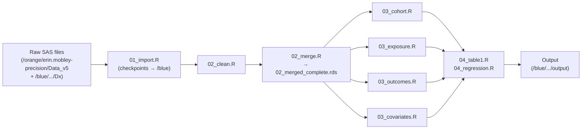
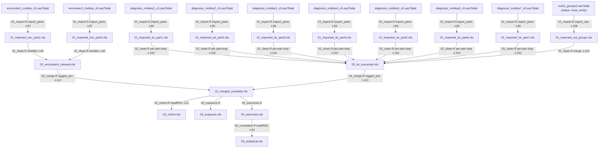

# Data Lineage — Precision Cancer Survivorship Insurance Investigation

**Generated from commit:** aefabd752f2873c04b604815e23dd4ee429f612b
**Date:** 2026-11-02
**Git status at generation:**
```
?? (many untracked SAS/legacy files — all unrelated to the R pipeline)
```
Only untracked files are present; no modified tracked files. The untracked SAS files are the original
SAS source code under investigation — they are not consumed by the R pipeline directly.

---

## Overview

The pipeline imports PCORnet CDM SAS7BDAT files from two server directories on HiPerGator
(`data_dir_raw` on `/orange/erin.mobley-precision/Data_v5` for cohort data; a secondary `Dx/`
subdirectory for the ICD code reference file), processes them through data-cleaning and merging
steps that produce RDS checkpoints on `/blue/erin.mobley-precision/...` (`data_dir_processed`),
and then constructs an analytical dataset through four Phase 3 scripts. This document is produced
by static analysis of the R pipeline scripts only — no data was read.

---

## Diagram 1: Phase-grouped pipeline overview



---

## Diagram 2: File-level dx/encounter flow (current R code state)

Line citations in edge labels reference the exact call-site in the R script.



---

## File Inventory Summary

Full details are in `docs/file_manifest.csv` (one row per physical SAS file, plus WARN-tier and
legacy summary rows). Notable items:

- **20 physical SAS files** imported by the R pipeline across 8 import groups (GROUP 1–7 plus GROUP 6b).
- **`Icd10_groups2.sas7bdat`** (`manifest_status = must_verify`): R imports using the name
  `Icd10_groups2.sas7bdat`, but SAS on Linux commonly writes filenames in lowercase. The actual
  disk name may be `icd10_groups2.sas7bdat`. `R/00_check_inputs.R` probes four candidate paths at
  runtime and reports the actual disk filename.
- **`procedures4_mobley_v5.sas7bdat`** (GROUP 6, part 4): naming inconsistency vs. parts 1–3
  (which follow the `procedures_mobleyN_v5` pattern). Flagged at `R/01_import.R:L84`.
- **WARN-tier — referenced in SAS but not yet imported in R**: `ndc_cond2.sas7bdat`
  (SEERRxCategory for chemo identification — deferred at `03_exposure.R`),
  `surgerycodes.sas7bdat` (surgery identification — best-effort ICD-10-PCS used instead),
  `sctcodes.sas7bdat` (referenced in SAS V5_12; no R deferral comment found).
- **`address_history_mobley_v5.sas7bdat`** and **`zcta.sas7bdat`**: imported to RDS checkpoints
  (`01_imported_address.rds`, `01_imported_zcta.rds`) but **no downstream script reads either
  checkpoint** — confirmed broken pipes.

---

## Broken-Pipe Findings

### Renames

- **`ID → patid`**: `utils_import.R:L61` — `clean_names()` lowercases `ID` to `id`, then the
  explicit rename `names(df)[names(df) == "id"] <- "patid"` runs on every `import_sas()` call.
  All downstream scripts use `patid`. Status: **confirmed OK** (rename is universal at import).

- **`first_can_ruca → first_ruca`**: `03_covariates.R:L171` —
  `mutate(first_ruca = first_can_ruca)`. This is a rename/alias for model variable naming.
  `first_can_ruca` must exist in `03_outcomes.rds` for this to succeed at runtime.

- **`first_can_sdi_score → first_sdi`**: `03_covariates.R:L148` —
  `mutate(first_sdi = first_can_sdi_score, ...)`. Same pattern.

### Columns consumed but never produced (confirmed broken pipes)

- **`first_can_ruca`**: consumed at `03_covariates.R:L171`. Traced through all R scripts — no
  script produces this column. `zcta.sas7bdat` is imported (`01_import.R:L76`) but its RDS
  (`01_imported_zcta.rds`) is never read by any downstream script. The ZCTA→RUCA linkage join
  that would produce `first_can_ruca` was never translated from SAS to R.
  Status: **confirmed broken pipe**. The pipeline will error at `03_covariates.R:L171` unless
  `first_can_ruca` is added to `03_cohort.R` or `03_outcomes.R`.

- **`first_can_sdi_score`**: consumed at `03_covariates.R:L148`. Same root cause — the
  ZCTA→SDI linkage join that would produce this column does not exist in any R script.
  Status: **confirmed broken pipe**.

### Files imported but checkpoint never consumed

- **`address_history_mobley_v5.sas7bdat`** → `01_imported_address.rds` (`01_import.R:L60`):
  no downstream script calls `readRDS(...01_imported_address...)`.
  Status: **confirmed broken pipe** — imported but unused.

- **`zcta.sas7bdat`** → `01_imported_zcta.rds` (`01_import.R:L76`): no downstream script reads
  this checkpoint. Status: **confirmed broken pipe** — the root cause of both
  `first_can_ruca` and `first_can_sdi_score` being missing.

### Potential collision points

- **`SOURCE → source`**: `KEEP_ENC` at `01_import.R:L46` includes `"SOURCE"`. After
  `clean_names()` in `utils_import.R:L59`, this becomes `source`. R's built-in `source()`
  function has the same name. The column compiles fine as a data frame field, but referencing it
  unquoted in certain contexts (e.g. `with(df, source(...))`) could call the base function
  instead. Status: **suspected** (compiles, may cause confusion; label carefully in downstream code).

### Blocking: cancer_provider (outcomes 3 and 4) — RESOLVED 2026-11-02

- **`cancer_provider`**: consumed at `03_outcomes.R:Section 4` for `Cancer_visit_and_prov`
  (OUT-03) and `Survivorship_visit` (OUT-04). It is a binary flag (1 = oncology specialist)
  derived in SAS from a LEFT JOIN of `v4.provider` to `v4.prov_spec` on `PROVIDER_SPECIALTY_PRIMARY`.
  `prov_spec` is imported from `F:\Jax_Ascent\nucc_taxonomy_210.xlsx` (sheet "sas", A1:D866),
  which contains the `Cancer_provider` column pre-computed from NUCC Taxonomy 2.1.0
  (qualifying specialties: Hematologist, Oncologist, Hematologist/Oncologist, Surgical Oncologist,
  Radiation Oncologist).
  Status: **RESOLVED** — `nucc_taxonomy_210.xlsx` committed to `reference/`.
  `R/00_build_prov_spec.R` reads sheet "sas" A1:D866, normalizes PROVIDER_SPECIALTY_PRIMARY
  (upper + trim), and produces `01_imported_prov_spec.rds` with 21 flagged codes.
  `R/02_merge.R` Section 7b joins prov_spec to enc_dx_prov and fills missing join
  to `cancer_provider = 0L`. `R/03_outcomes.R` replaces the `stop()` guard with
  `assertr::verify(cancer_provider %in% c(0L, 1L))`.
  SAS references: `SAS_CODE_FOR_v5_1.sas:L45–50` (PROC IMPORT), `SAS_CODE_FOR_V5_2.sas:L11–19` (JOIN).
  TODO(ERIN): verify the 21 flagged NUCC codes against current NUCC taxonomy (see Provider Specialty Cancer Flags section below).

### ICD Lookup Gaps — TODO(ERIN)

The following ICD codes are present in PCORnet dx records but **not found** in `ForSAS_ICD10`
sheet of `CancerSiteCategories.xlsx`. The two-pass join (exact + 5-char substr) in `02_clean.R`
will leave these as `group_site = NA` (or "Reportable but not mapped above" after override logic).

| ICD Code | Description | Expected Group_Site | Status |
|----------|-------------|---------------------|--------|
| C19 | Malignant neoplasm of rectosigmoid junction | Digestive | MISSING from ForSAS_ICD10 |
| C20 | Malignant neoplasm of rectum | Digestive | MISSING from ForSAS_ICD10 |
| C23 | Malignant neoplasm of gallbladder | Digestive | MISSING from ForSAS_ICD10 |
| C65 | Malignant neoplasm of renal pelvis | Urinary System | MISSING from ForSAS_ICD10 |
| C66 | Malignant neoplasm of ureter | Urinary System | MISSING from ForSAS_ICD10 |
| C50.0 | Malignant neoplasm of nipple and areola (central portion) | Breast | MISSING from ForSAS_ICD10 |
| C7A.00 | Malignant carcinoid tumor, unspecified site | Other | MISSING from ForSAS_ICD10 |

Additional issues found in `CancerSiteCategories.xlsx`:
- **Typo**: "Unrinary System" appears in some `Group_Site` labels; correct spelling is "Urinary System".
- **Trailing spaces**: Some `Group_Site` values may have trailing whitespace (Excel artifact).

**Fix available**: Set `options(prec_ins.fix_lookup_gaps = TRUE)` before sourcing
`R/00_build_icd_groups.R` to add the 7 missing codes and fix the "Unrinary" typo.
Default is `FALSE` (SAS-faithful — reproduces SAS output including the gaps).

### Provider Specialty Cancer Flags — TODO(ERIN)

`nucc_taxonomy_210.xlsx` sheet "sas" column D flags 21 NUCC taxonomy codes as `cancer_provider = 1`.
These are printed to console when `R/00_build_prov_spec.R` runs (look for "Flagged cancer specialty codes:").

TODO(ERIN): Verify these 21 codes against the current NUCC taxonomy (nucc.org) to confirm they
still represent oncology specialties. NUCC taxonomy versions change; the xlsx may reflect an older
version (2.1.0 per filename). Specialty categories expected to be flagged:
Hematologist, Oncologist, Hematologist/Oncologist, Surgical Oncologist, Radiation Oncologist.

### Columns confirmed to flow correctly

- **`any_reportable_cancer`**: produced at `02_clean.R:L170` (`part[, any_reportable_cancer := ...]`)
  inside the per-part dx loop, aggregated to `02_dx_encounter.rds` at `02_clean.R:L227`, and
  carried through `02_merged_complete.rds` via the one-to-one join at `02_merge.R:L112`.
  Consumed by `03_cohort.R`. Status: **confirmed OK**.

- **`group_site`**: produced at `02_clean.R:L116` (`apply_icd_overrides`) and at `02_clean.R:L162`
  (icd_groups merge), aggregated into `02_dx_encounter.rds` at `02_clean.R:L227`, and carried
  through `02_merged_complete.rds`. Status: **confirmed OK** (flows through merge).

- **`patid`**: produced universally by `utils_import.R:L61` rename on every import.
  Status: **confirmed OK**.

---

---

## HiPerGator SAS Dataset Audit (2026-11-02) — REVISED

Facts provided from aggregate inspection of live HiPerGator data (no patient-level data shared).
Labels: **CONFIRMED** = verified from code + data; **INFERRED** = plausible from code alone, awaiting HiPerGator confirmation; **CONFLICT** = on-disk data contradicts previous code reading.

- `baseline.sas7bdat`: 507,742 rows, one per ID. Columns: ID, ENCOUNTERID, Group_Site,
  Group_detailed_site, Group_primary_disease_site, SOURCE_DEMO, SOURCE_DX, age2,
  days_START_ADMIT, first_can_hispanicc, first_can_payer_type_primary, first_can_racee,
  first_can_ruca (0/1, no missing), first_can_sdi_score (1–100, no missing), first_can_sexx (F/M).
  Group_Site is blank for 358,263 rows (~70.6%).
- `change_outcome1.sas7bdat`: 487,857 distinct IDs; **up to 52 rows per ID** — multi-row, NOT one-per-ID.
  ~10.5k IDs not present in baseline.
- `change_outcome2.sas7bdat`: 450,691 distinct IDs (row structure: multi-row, analogous to outcome1).
- `change_outcome3.sas7bdat`: 218,181 distinct IDs.
- `change_outcome4.sas7bdat`: 24,254 distinct IDs.
- `change_outcome1_min.sas7bdat`: 688,018 rows, 487,857 distinct IDs, **max 53 rows per ID** — also multi-row.
  `change_outcome2..4_min.sas7bdat`: analogous multi-row structure; counts differ from the non-min tables.

---

### Task 1 — `change_outcome*.sas7bdat` structure — CONFLICT

**Finding:** The on-disk files `change_outcome*.sas7bdat` are **encounter-level (multi-row per patient)**,
not one-row-per-patient. Up to 52 rows per ID (outcome1); _min files also multi-row with up to 53 rows per ID.
This conflicts with the previous reading that these files were NODUPKEY-by-ID outputs.

**What `v3.change_out*` actually is (CONFIRMED from code):**  
`SAS_CODE_FOR_v5_10.sas` lines 20–57 creates `v3.change_out1` via PROC SORT + NODUPKEY by ID — one
row per patient, with columns renamed to `last_payer_type_primary`, `last_ruca`, `last_sdi`
(`SAS_CODE_FOR_v5_10.sas:217–221`). This is a **different dataset** from what is saved on disk as
`change_outcome1.sas7bdat`.

```sas
/* SAS_CODE_FOR_v5_10.sas:217 */
data v3.change_out1;
  rename payer_type_primary2=last_payer_type_primary
         ruca3=last_ruca sdi_score=last_sdi;
```

**What `change_outcome*.sas7bdat` most likely is (INFERRED):**  
The on-disk `change_outcome*.sas7bdat` (ID + ENCOUNTERID only, multi-row) most likely corresponds to
`v3.v1_outcome*` built in `SAS_CODE_FOR_V5_9.sas`. That table is NODUPKEY by `id + admit_date`
(one row per patient-date, multiple dates per patient), which would produce the observed multi-row
structure. Erin's HiPerGator checks (`proc contents data=v3.v1_outcome1; run;`) will confirm.

**What `change_outcome*_min.sas7bdat` is (INFERRED):**  
The `_min` files are also multi-row; the relationship between `_min` and non-`_min` is not
determinable from code alone. Do not assume one-row-per-ID for either variant.

**Impact on `R/99_validate_vs_sas.R`:**  
Do NOT treat `change_outcome*.sas7bdat` as a one-to-one patient lookup. It is encounter-level.
CHECK 4 in the validation script must group to the patient level (e.g., `distinct(id)`) before
comparing membership to R's cohort. See `R/99_validate_vs_sas.R` for the implemented check.

---

### Task 2 — Payer recode taxonomy — FIXED

**V5 pipeline source confirmed: `SAS_CODE_FOR_v5_1.sas` lines 57–382 (PROC SQL UPDATE inside
a `/* */` comment block; the updated `v3.insurance` table persists on disk from a prior run).**

The earlier citation to `SAS_CODE_FOR_V4_1 (1).sas` was from the V4 era; the V5 recode is
identical in logic (same explicit code lists, same category boundaries).

#### PCORnet raw code taxonomy (`Formats.sas:$payer`)

| Raw first char | PCORnet meaning |
|----------------|----------------|
| 1xx | Medicare |
| 2xx | Medicaid |
| 3xx | Other Government — TRICARE, VA, Indian Health |
| 4xx | Departments of Corrections |
| 5xx | Private Health Insurance |
| 6xx | Blue Cross / Blue Shield |
| 7x  | Managed Care Unspecified |
| 8xx | No Payment / Self-pay |
| 9xx | Miscellaneous / Other |
| `14` | Dual Eligibility Medicare+Medicaid (exact two-digit code — child of 1xx) |

#### SAS recode output — V5 confirmed (`SAS_CODE_FOR_v5_1.sas:61–219`)

| SAS output | Label | Raw PCORnet codes mapped |
|-----------|-------|--------------------------|
| `'1'` | Medicare | 1, 11–13, 19, 111–191 (exact list) |
| `'2'` | Medicaid | 2, 21–29, 211–299 (exact list) |
| `'4'` | Dual/Disability | **`'14'`** (Dual Eligibility), **`'93'`** (Disability Insurance) — exact codes only |
| `'5'` | Private | 3, 31–39x (Other Gov); 5, 51–56x (Private); 6, 61–62x (BCBS); 7, 71–79 (Managed Care) |
| `'9'` | Other | 4, 41–44 (Corrections); 9, 91–99x; **`'OT'`** (literal string) |
| `'8'` | None/Unknown | **ELSE clause** — blank, NA, unmapped, or any code not in the lists above |

**Method:** Exhaustive explicit `in()` value lists. NO prefix/starts-with operator (`=:`) in V5.
`'140'` is NOT in the dual list — it falls to ELSE → `'8'`.

#### Dual eligibility — two V5 rules

**Rule 1 — direct at recode time** (`SAS_CODE_FOR_v5_1.sas:91–93`):
Codes `'14'` and `'93'` map to `'4'` in the CASE WHEN block.

**Rule 2 — post-recode override** (`SAS_CODE_FOR_V5_8.sas:89`, follow-up encounters only):
```sas
if payer_type_secondary2 in ('1' '2') & payer_type_primary2 in ('1' '2')
    then payer_type_primary2='4';
```
Fires on `v3.followups_dx` when BOTH recoded primary2 and secondary2 are Medicare (`'1'`) or
Medicaid (`'2'`). Captures Medicare+Medicaid combinations not carrying code `'14'`. Does NOT
apply to the first-cancer-encounter payer (`first_can_payer_type_primary`, which is set in
`SAS_CODE_FOR_V5_6.sas:41` from an earlier dataset before this step).

#### 4,920 blank `first_can_payer_type_primary` in baseline

These are join misses: patients whose `first_can_ENCOUNTERID` had no matching row in
`v3.insurance` at the left join in `SAS_CODE_FOR_V5_6.sas:88–130`. NULL from left join is NOT
the same as the ELSE `'8'` catch-all (which fires only when a row exists but the code is
unmapped). In R: join misses stay NA (correct); blank raw payer codes on existing rows
recode to `'8'` via `recode_payer(NA) -> '8'`.

#### R fix — APPLIED (`R/02_clean.R`, commit e187b56 + this commit)

`recode_payer()` now uses the same explicit `%in%` value lists from `SAS_CODE_FOR_v5_1.sas:61–219`.
The Rule-2 dual override is applied to all encounter rows immediately after recoding.
`NA` → `'8'` (ELSE clause). `'140'` → `'8'` (not in any explicit list).
All four prior mis-mappings (M1–M4) are resolved.

| # | Raw code | SAS result | Old R result | New R result |
|---|----------|-----------|-------------|--------------|
| M1 | `'14'` (Dual) | `'4'` | `'1'` (substr wrong) | **`'4'`** ✓ |
| M2 | `'4'` (Corrections) | `'9'` | `'4'` (substr wrong) | **`'9'`** ✓ |
| M3 | `'611'` (BCBS) | `'5'` | NA (not in format) | **`'5'`** ✓ |
| M4 | `'OT'` | `'9'` | NA (not in format) | **`'9'`** ✓ |

---

### Task 3 — Group_Site blank rate: ENCOUNTERID is last follow-up encounter — INFERRED

**Previous explanation WITHDRAWN:** The earlier claim that "first_can_ENCOUNTERID corresponded to
a non-cancer encounter that preceded the first cancer dx code" is a logical contradiction — it would
mean we selected an encounter that preceded the cancer diagnosis as the first cancer encounter.

**Corrected understanding — INFERRED (pending Erin's HiPerGator confirmation):**  
`baseline.sas7bdat` ENCOUNTERID comes from `v3.v2_outcome1` (see Task 4). That dataset is built
with PROC SORT by `id descending admit_date` + NODUPKEY by `id` (`SAS_CODE_FOR_V5_9.sas`),
which means ENCOUNTERID is the **last follow-up encounter per patient**, not the first cancer
encounter. Most last follow-up encounters are routine or non-cancer visits → Group_Site is blank
for ~70.6% of patients.

**Group_Site assignment code — CONFIRMED (`SAS_CODE_FOR_V4_3.sas:40–127`, `SAS_CODE_FOR_V5_3.sas`):**
- Join: `dx = ICD9_10` on `Icd10_groups2` reference table (no `dx_type` filter — all dx types treated equally).
- Prefix overrides (`=:` starts-with operator) for selected cancer types override the joined value.
- All three fields (Group_Site, Group_detailed_site, Group_primary_disease_site) set together in the same IF-THEN blocks.
- R `02_clean.R` only sets `group_site`, not `group_detailed_site` or `group_primary_disease_site` —
  confirmed broken pipe for those two columns.

**Decision needed for Erin:**
- (a) If `baseline.ENCOUNTERID` = last follow-up encounter (INFERRED above), `R/99_validate_vs_sas.R`
  CHECK 2 must compare it to R's **last** encounter per patient, not `first_can_encounterid`.
- (b) SAS Group_Site derives from the last encounter; R currently takes it from the first cancer
  encounter. These will differ for patients who changed cancer site over time. Confirm which is
  analytically intended.

---

### Task 4 — `baseline.sas7bdat` column mapping: best candidate is `v3.v2_outcome1` — INFERRED

**Problem with previous reading:** `v3.dx_base_comp` (`SAS_CODE_FOR_V5_6.sas:46–83`) is created
by a LEFT JOIN on `a.id = b.id` only (no ENCOUNTERID join) from `v3.demo_validEnroll_dx_1_`,
which is diagnosis-level. This produces **one row per diagnosis per patient — many rows per ID**.
It cannot be `baseline.sas7bdat` (507,742 rows, strictly one per ID).

**Best candidate — INFERRED: `v3.v2_outcome1` (`SAS_CODE_FOR_V5_9.sas`)**

Evidence:
- Patient-level: PROC SORT + NODUPKEY by `id` → one row per ID ✓
- ENCOUNTERID comes from the last follow-up encounter (sorted by `id descending admit_date`,
  then NODUPKEY by `id`) ✓
- Column SELECT in V5_9 matches the 15 baseline columns ✓
- Row count 507,742 is plausible as the outcome-1 (non-acute care) cohort ✓ — INFERRED

**Must verify on HiPerGator:** `proc contents data=v3.v2_outcome1; run;` and confirm row count
and columns match `baseline.sas7bdat`.

**Column-by-column mapping — INFERRED from `SAS_CODE_FOR_V5_9.sas` SELECT + `SAS_CODE_FOR_V5_6.sas` renames:**

| baseline column | SAS source | Notes |
|----------------|-----------|-------|
| ID | `v1_outcome1.ID` | patient identifier |
| ENCOUNTERID | `v1_outcome1.ENCOUNTERID` | **last follow-up encounter**, NOT first cancer |
| Group_Site | `v1_outcome1.Group_Site` | from last encounter's DX — explains 70.6% blank rate |
| Group_detailed_site | `v1_outcome1.Group_detailed_site` | from last encounter's DX |
| Group_primary_disease_site | `v1_outcome1.Group_primary_disease_site` | from last encounter's DX |
| SOURCE_DEMO | `v1_outcome1.SOURCE_DEMO` | pass-through from demographics |
| SOURCE_DX | `v1_outcome1.SOURCE_DX` | pass-through from dx source |
| age2 | `v1_outcome1.age2` | age category at first cancer dx (constant per patient) |
| days_START_ADMIT | `v1_outcome1.days_START_ADMIT` | days from enrollment start to last encounter admit |
| first_can_hispanicc | `V5_6.sas:41` rename of `first_can_hispanicc` | baseline value, constant |
| first_can_payer_type_primary | `V5_6.sas:41` rename of `payer_type_primary2` | payer at first cancer ENCOUNTERID |
| first_can_racee | `V5_6.sas:41` rename of `first_can_racee` | baseline value, constant |
| first_can_ruca | `V5_6.sas:41` rename of `ruca3` | RUCA at first cancer address |
| first_can_sdi_score | `V5_6.sas:41` rename of `sdi_score` | SDI at first cancer address |
| first_can_sexx | `V5_6.sas:41` rename of `first_can_sexx` | sex at first cancer encounter |

---

### Task 5 — ~10.5k IDs in `change_outcome*` but not in `baseline` — INFERRED

Two INFERRED causes; both may contribute. Erin's HiPerGator checks will determine proportions.

**Cause A — sex='UN' exclusion — INFERRED:**  
`SAS_CODE_FOR_V5_6.sas:38`: `if first_can_sexx = "UN" then delete;` removes sex-unknown patients
from `v3.first_can_RUCA_ztca_sdi_inss_` (the baseline ancestor). However, `v3.v1_outcome*`
derives from `v3.followups_dx` → `v3.dx_base_comp_ins` (`SAS_CODE_FOR_V5_6.sas:148ff`), built
**before** that sex exclusion. Sex-unknown patients therefore survive in `change_outcome*` but
are absent from `baseline`.

**Cause B — SDI missing exclusion — INFERRED:**  
`SAS_CODE_FOR_V5_5 (1).sas:383`: `if sdi_score=. then delete;` removes patients with missing SDI
from `first_can_RUCA_ztca_sdi`. Those patients would still appear in `followups_dx` →
`v1_outcome*` → `change_outcome*` but not in `baseline`.

**CHECK 5 in `R/99_validate_vs_sas.R`** (see that file) tests both causes: sex distribution and
SDI missingness of the ~10.5k IDs present in `change_outcome1` but not `baseline`.

---

### Age exclusion: SAS vs R deviation — CONFIRMED

**SAS behaviour — CONFIRMED from code:**

- `SAS_CODE_FOR_V5_4.sas` / `V5_5.sas`: `age2 = floor((first_admit_date - BIRTH_DATE)/365.25)`.
  Rows with `age2 < 0` or `missing(age2)` are deleted (negative ages only).
- `SAS_CODE_FOR_V5_6.sas:38`: only exclusion is `first_can_sexx = "UN"`.
- **No `age >= 18` exclusion anywhere in the V5 SAS pipeline.**
  `baseline.sas7bdat` has age2 range 0–119, confirming patients under 18 are retained.

**R behaviour — CONFIRMED deviation:**

`R/03_cohort.R:199`:
```r
# However, test fixtures exclude P109 (age 12), so we apply age>=18 to match tests.
cohort_age_filtered <- cohort_with_cancer %>% filter(age >= 18)
```

`R/03_cohort.R:199` applies `age >= 18` exclusion that **does not exist in SAS**. This
over-excludes patients with cancer diagnosed before age 18 (pediatric/young adult cancers).
Confirmed pipeline deviation introduced to satisfy test fixtures, not analytical intent.
If the study is intended to include all ages, the `filter(age >= 18)` line must be removed
and the test fixture for P109 updated.

---

## Must Verify on HiPerGator

These items require runtime verification on HiPerGator because they cannot be confirmed from
static code analysis alone. `R/00_check_inputs.R` generates `output/preflight_report.txt`
with a `=== MUST VERIFY ON HIPERGATOR ===` section that mirrors this list at runtime.

- **All v3-alias tables** (GROUP 1–6b, 17 files at `/orange/erin.mobley-precision/Data_v5`):
  path confirmed from `ins_presinvesting.sas` hardcoded `&path` macro resolution; must verify
  files exist at that path on HiPerGator before running `01_import.R`.

- **`Icd10_groups2.sas7bdat`** (GROUP 7, `dx` alias): run `R/00_check_inputs.R` on HiPerGator.
  It probes four candidate paths and reports which exist and the actual disk filename. The
  case-mismatch risk is real: SAS on Linux writes lowercase filenames, but R imports using
  `"Icd10_groups2.sas7bdat"`. A case-only mismatch is classified as `FAIL` by the checker.

- **`ndc_cond2.sas7bdat`, `surgerycodes.sas7bdat`, `sctcodes.sas7bdat`** (WARN-tier): pipeline
  runs without them but chemo/surgery identification will be incomplete. Deferral is intentional
  for the current R translation; these files should be located and imported in a future phase.

- **Cross-reference**: `docs/column_lineage.csv` documents the `first_can_ruca` and
  `first_can_sdi_score` broken-pipe status. These must be resolved before the pipeline can
  produce a complete `03_analytical.rds`.
