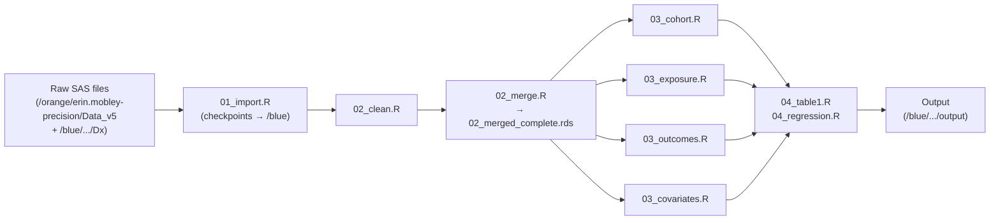
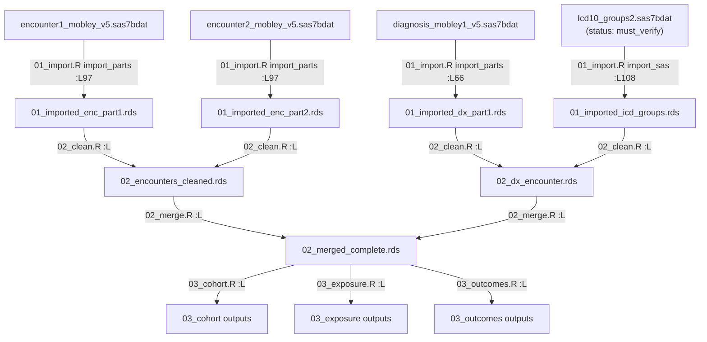

# Phase 05: Data Lineage and File Inventory — Implementation Plan

> **For agentic workers:** REQUIRED SUB-SKILL: Use superpowers:subagent-driven-development (recommended) or superpowers:executing-plans to implement this plan task-by-task. Steps use checkbox (`- [ ]`) syntax for tracking.

**Goal:** Produce four deliverables that account for every SAS input file and how it flows through the R pipeline: `docs/file_manifest.csv`, `docs/column_lineage.csv`, `R/00_check_inputs.R` (standalone HiPerGator preflight checker), and `docs/DATA_LINEAGE.md` (narrative + Mermaid diagrams).

**Architecture:** Static code analysis only — no data is read. The manifest (one row per physical SAS file) and column lineage are built by reading R pipeline scripts. The preflight checker reads the manifest at runtime and probes file headers via `haven::read_sas(n_max = 0)`. The narrative synthesizes everything.

**Tech Stack:** R, haven, here, testthat; Markdown with Mermaid for diagrams.

**Spec:**
- `.planning/phases/05-data-lineage-and-file-inventory-account-for-the-location-of-every-input-file-and-how-it-flows-through-the-pipeline/05-CONTEXT.md` — locked decisions D-01 through D-14
- `.planning/phases/05-data-lineage-and-file-inventory-account-for-the-location-of-every-input-file-and-how-it-flows-through-the-pipeline/05-RESEARCH.md` — SAS alias inventory, file inventory, broken-pipe candidates, architecture patterns
- User revisions (override spec where they conflict — see Global Constraints below)

## Global Constraints

- Language: R with tidyverse ecosystem; `00_check_inputs.R` uses only `haven` and `here` (no tidyverse needed in preflight).
- `00_check_inputs.R` must source only `R/config.R` — NEVER `utils_import.R` or `import_sas()`.
- Header reads: `haven::read_sas(path, n_max = 0)` called directly; wrap in `tryCatch`, fall back to `n_max = 1` on error **or** if rows are returned; return `names(result)`.
- Case-sensitive filesystem (Linux): file existence must use `list.files()` + `tolower()` comparison, never `file.exists()` alone.
- Preflight injectable: `run_preflight(manifest_path, raw_dir, dx_dirs, report_dir, write_reports)` — tests call it with `tempdir()` paths.
- Overall result is **PASS / FAIL / INCOMPLETE** (three states): FAIL if any imported-file check is FAIL; INCOMPLETE if any required directory is unreachable; PASS only when zero FAIL rows and at least one directory was reachable. `missing_in_r` (WARN) rows never affect the overall result.
- A case-only filename match counts as **FAIL** for imported files (latent bug that will break on a case-sensitive filesystem).
- An unreachable directory gives per-row status **INCOMPLETE** (not FAIL, not error).
- Manifest `manifest_status` (static, from the CSV) is separate from runtime `check_result` (produced by the checker).
- One result row per dx candidate path probed.
- Skip manifest rows that have no concrete `sas_filename` (summary/legend rows only); rows with `manifest_status == missing_in_r` are probed but never cause FAIL.
- File count for imported tables: **20 physical files** (verified from `R/01_import.R`).
- `Icd10_groups2.sas7bdat` gets `manifest_status = must_verify`; note "suspected case mismatch — SAS on Linux writes lowercase; verify disk name on HiPerGator".
- `docs/` directory does not yet exist — Task 1 creates it.
- Testthat framework is established (`tests/testthat/`). Match existing style from `tests/testthat/test_03_cohort.R`: `library(testthat)`, `test_that()` blocks, `expect_*` assertions. Tests set `Sys.setenv(PIPELINE_TEST = "TRUE")` before sourcing `00_check_inputs.R`.
- Acceptance criteria grep for **executable calls** (function definitions, function calls), not comment text.
- No data access at any point.

## Review Focus

1. **Case-only mismatch classified as FAIL, not WARN**: a file found by case-insensitive match where `disk_name != r_import_name` must produce `check_result = "FAIL"` for imported tables, not just a note. A test must confirm this.
2. **INCOMPLETE vs FAIL for unreachable dirs**: when `dir.exists(raw_dir)` is FALSE, the row must yield `check_result = "INCOMPLETE"`, not FAIL. A test with a non-existent temp raw_dir must assert this.
3. **dx multi-path produces one row per candidate**: if all four dx candidates are unreachable locally, the result data.frame should have four rows for the `Icd10_groups2` table entry, each with `check_result = "INCOMPLETE"`. A test must confirm row count.
4. **`read_header_cols()` tryCatch path**: when `read_sas()` throws (e.g. corrupt or absent file), the function must return `character(0)` without propagating the error. Test with a mocked reader that throws.
5. **DATA_LINEAGE.md edge citations**: every Mermaid arrow and every broken-pipe claim in the narrative must cite a script + line number. A grep check on the final document for at least one `:L` pattern (line citation format) confirms this is present, but the implementer must apply it to every edge.

---

## File Structure

| Path | Action | Responsibility |
|------|--------|----------------|
| `docs/file_manifest.csv` | Create | One row per physical SAS file; static classification |
| `docs/column_lineage.csv` | Create | One row per raw SAS column per table |
| `docs/DATA_LINEAGE.md` | Create | Narrative + two Mermaid diagrams |
| `R/00_check_inputs.R` | Create | Standalone preflight checker |
| `tests/testthat/test_check_inputs.R` | Create | Unit tests for preflight helpers and probe logic |

---

## Interfaces (shared across all tasks)

### Manifest CSV schema
```
alias,table_group,sas_filename,hipergator_path,r_import_call,r_checkpoint_rds,
expected_raw_cols,downstream_consumers,manifest_status,r_import_name,disk_name,notes
```

Field notes:
- `alias` — SAS LIBNAME alias (`v3`, `dx`)
- `table_group` — GROUP label from `R/01_import.R` (GROUP 1 … GROUP 7, WARN, LEGACY)
- `sas_filename` — exact physical filename (no synthetic group names)
- `hipergator_path` — resolved directory (or "multiple candidates — see notes" for dx rows)
- `r_import_call` — one of: `import_and_save`, `import_parts`, `import_sas`
- `r_checkpoint_rds` — exact RDS name written (e.g. `01_imported_dx_part1.rds`)
- `expected_raw_cols` — pipe-delimited SAS source column names from KEEP_* vectors; `ALL` for full-read tables
- `downstream_consumers` — pipe-delimited scripts that read the checkpoint
- `manifest_status` — `ok` / `missing_in_r` / `unused` / `mismatch` / `must_verify`
- `r_import_name` — the filename string `01_import.R` passes to `read_sas` (may differ in case from disk)
- `disk_name` — suspected or confirmed on-disk filename; NA when unknown
- `notes` — human-readable details

### Column lineage CSV schema
```
table,column,origin,created_in,consumed_by
```
- `origin` — `raw` / `renamed` / `derived`
- `consumed_by` — pipe-delimited script list

### `check_file_ci(dir_path, filename)` → `list(found, disk_name)`
```r
check_file_ci <- function(dir_path, filename) {
  if (!dir.exists(dir_path)) return(list(found = FALSE, disk_name = NA_character_))
  files_on_disk <- list.files(dir_path)
  match_idx <- which(tolower(files_on_disk) == tolower(filename))
  if (length(match_idx) == 0) return(list(found = FALSE, disk_name = NA_character_))
  list(found = TRUE, disk_name = files_on_disk[match_idx[1]])
}
```

### `read_header_cols(path)` → `character()`
Wraps `haven::read_sas(path, n_max = 0)` in `tryCatch`; falls back to `n_max = 1` on error **or** if the result has rows; returns `names(result)` or `character(0)` on unrecoverable error.

### `run_preflight(manifest_path, raw_dir, dx_dirs, report_dir, write_reports)` → `data.frame`
Returns one row per file–candidate-path combination checked. Columns include at minimum: `table`, `sas_filename`, `path_probed`, `manifest_status`, `check_result`, `disk_name`, `r_import_name`, `expected_cols_missing`, `notes`. The function is the callable entry point; execution when the script is run directly is guarded by `if (!interactive() && sys.nframe() == 0)`.

### `run_preflight` default arguments (resolved after `source(here::here("R","config.R"))`)
```r
run_preflight <- function(
  manifest_path = here::here("docs", "file_manifest.csv"),
  raw_dir       = data_dir_raw,
  dx_dirs       = c(data_dir_raw,
                    file.path(data_dir_raw, "Dx"),
                    "/blue/erin.mobley-precision/ResVault/f/Dx",
                    "/orange/erin.mobley-precision/f/Dx"),
  report_dir    = output_dir,
  write_reports = TRUE
)
```

### Physical file count (from `R/01_import.R`, verified)
20 imported files:
- GROUP 1 (3): `demographic_mobley_v5.sas7bdat`, `enrollment_mobley_v5.sas7bdat`, `address_history_mobley_v5.sas7bdat`
- GROUP 2 (7): `diagnosis_mobley1_v5.sas7bdat` … `diagnosis_mobley7_v5.sas7bdat`
- GROUP 3 (1): `provider_mobley_v5.sas7bdat`
- GROUP 4 (1): `zcta.sas7bdat`
- GROUP 5 (1): `dispensing_mobley_v5.sas7bdat`
- GROUP 6 (4): `procedures_mobley1_v5.sas7bdat`, `procedures_mobley2_v5.sas7bdat`, `procedures_mobley3_v5.sas7bdat`, `procedures4_mobley_v5.sas7bdat`
- GROUP 6b (2): `encounter1_mobley_v5.sas7bdat`, `encounter2_mobley_v5.sas7bdat`
- GROUP 7 (1): `Icd10_groups2.sas7bdat`

### KEEP_* vectors (from `R/01_import.R` lines 35–46, verbatim)
```r
KEEP_DX   <- c("ID","DIAGNOSISID","ENCOUNTERID","DX","DX_TYPE","DX_DATE","DX_SOURCE","PDX")
KEEP_PROC <- c("ID","PROCEDURESID","ENCOUNTERID","PX","PX_TYPE","PX_DATE","PX_SOURCE","PPX")
KEEP_DISP <- c("ID","DISPENSINGID","NDC","DISPENSE_DATE","DISPENSE_SUP","DISPENSE_AMT")
KEEP_ENC  <- c("ID","ENCOUNTERID","ADMIT_DATE","DISCHARGE_DATE","ENC_TYPE",
               "DISCHARGE_STATUS","DISCHARGE_DISPOSITION","PAYER_TYPE_PRIMARY",
               "PAYER_TYPE_SECONDARY","PROVIDERID","FACILITYID","DRG","SOURCE")
```

---

## Task 1: Scaffold — docs directory, CSV headers, skeleton checker, behavioral tests

**Files:**
- Create: `docs/.gitkeep`
- Create: `docs/file_manifest.csv` (header only)
- Create: `docs/column_lineage.csv` (header only)
- Create: `R/00_check_inputs.R` (skeleton)
- Create: `tests/testthat/test_check_inputs.R`

**Interfaces:**
- Produces: `check_file_ci(dir_path, filename)` and `read_header_cols(path)` in `R/00_check_inputs.R`; stub `run_preflight` placeholder. Task 2 populates CSVs. Task 3 fills the probe loop.

- [ ] **Step 1: Write the failing tests for `check_file_ci` and `read_header_cols`**

```r
# tests/testthat/test_check_inputs.R
library(testthat)
Sys.setenv(PIPELINE_TEST = "TRUE")
source(here::here("R", "00_check_inputs.R"))

test_that("check_file_ci finds file with case-mismatched query", {
  tmp <- tempfile(); dir.create(tmp)
  file.create(file.path(tmp, "icd10_groups2.sas7bdat"))
  res <- check_file_ci(tmp, "ICD10_GROUPS2.SAS7BDAT")
  expect_true(res$found)
  expect_equal(res$disk_name, "icd10_groups2.sas7bdat")
})

test_that("check_file_ci returns found=FALSE for non-existent directory", {
  res <- check_file_ci("/no/such/dir/abc123", "anything.sas7bdat")
  expect_false(res$found)
  expect_true(is.na(res$disk_name))
})

test_that("check_file_ci returns found=FALSE when file absent from existing dir", {
  tmp <- tempfile(); dir.create(tmp)
  res <- check_file_ci(tmp, "ghost.sas7bdat")
  expect_false(res$found)
})

test_that("read_header_cols returns character(0) when reader throws", {
  # Mock read_sas to throw
  local_mocked_bindings(
    read_sas = function(...) stop("simulated read error"),
    .package = "haven"
  )
  result <- read_header_cols("/fake/path.sas7bdat")
  expect_equal(result, character(0))
})

test_that("read_header_cols falls back to n_max=1 when n_max=0 returns rows", {
  call_count <- 0L
  local_mocked_bindings(
    read_sas = function(path, n_max, ...) {
      call_count <<- call_count + 1L
      if (n_max == 0) return(data.frame(a = 1, b = 2))  # simulate non-zero return
      data.frame(a = integer(0), b = integer(0))          # n_max=1 but discard
    },
    .package = "haven"
  )
  result <- read_header_cols("/fake/path.sas7bdat")
  expect_equal(call_count, 2L)
  expect_equal(sort(result), c("a", "b"))
})
```

- [ ] **Step 2: Run tests to verify they fail**

```
PIPELINE_TEST=TRUE Rscript -e "testthat::test_file('tests/testthat/test_check_inputs.R')"
```
Expected: FAIL — `check_file_ci` and `read_header_cols` not yet defined.

- [ ] **Step 3: Create `docs/` with `.gitkeep` and CSV headers**

Create `docs/.gitkeep` (empty file).

Create `docs/file_manifest.csv` with exactly this header line and a trailing newline:
```
alias,table_group,sas_filename,hipergator_path,r_import_call,r_checkpoint_rds,expected_raw_cols,downstream_consumers,manifest_status,r_import_name,disk_name,notes
```

Create `docs/column_lineage.csv` with exactly this header line and a trailing newline:
```
table,column,origin,created_in,consumed_by
```

- [ ] **Step 4: Create `R/00_check_inputs.R` skeleton**

The file must contain (in order):
1. Comment block stating: standalone preflight; sources only `R/config.R`; never sources `utils_import.R` or calls `import_sas()`; reads headers only via `haven::read_sas(path, n_max = 0)`.
2. `library(here)`, then `source(here::here("R", "config.R"))`, then `library(haven)`.
3. `check_file_ci(dir_path, filename)` — exact implementation from the Interfaces block above.
4. `read_header_cols(path)` — `tryCatch` wrapping `haven::read_sas(path, n_max = 0)`; if the call throws, return `character(0)`; if the result has rows, call again with `n_max = 1`, log via `message()` which fallback triggered, discard rows and return `names()`; otherwise return `names(result)`.
5. A clearly-marked placeholder comment: `# === PROBE LOOP: implemented in Task 3 ===`.
6. A guarded main invocation stub: `if (!interactive() && sys.nframe() == 0) message("Probe loop not yet implemented.")`.

- [ ] **Step 5: Run tests to verify they pass**

```
PIPELINE_TEST=TRUE Rscript -e "testthat::test_file('tests/testthat/test_check_inputs.R')"
```
Expected: all 5 tests PASS.

- [ ] **Step 6: Commit**

```bash
git add docs/.gitkeep docs/file_manifest.csv docs/column_lineage.csv \
        R/00_check_inputs.R tests/testthat/test_check_inputs.R
git commit -m "feat(05): scaffold docs, CSV headers, check_inputs skeleton + behavioral tests"
```

---

## Task 2: Populate CSVs — file manifest and column lineage

**Files:**
- Modify: `docs/file_manifest.csv` (append 30+ data rows)
- Modify: `docs/column_lineage.csv` (append 50+ data rows)

**Interfaces:**
- Consumes: CSV headers from Task 1; KEEP_* vectors and import calls from `R/01_import.R`; broken-pipe candidates from `05-RESEARCH.md` section "Column-Level Broken Pipe Candidates"; SAS alias inventory from `05-RESEARCH.md`
- Produces: populated CSVs consumed by Task 3 (probe loop reads manifest) and Task 4 (narrative)

**Read before implementing:**
- `R/01_import.R` — full file: KEEP_* vectors (lines 35–46), import calls (lines 58–116), GROUP labels, procedures4 naming note (line 84), icd_groups dual-path logic (lines 104–115)
- `R/utils_import.R` — `ID → patid` rename logic (~line 61)
- `R/02_clean.R` — `any_reportable_cancer` derivation; `apply_icd_overrides`; `02_encounters_cleaned.rds` and `02_dx_encounter.rds` output names; surgerycodes/ndc_cond2 deferral comments
- `R/02_merge.R` — `02_merged_complete.rds` output; `group_site` flow note; prov_spec absorption note (~line 127)
- `R/03_cohort.R` — reads of `any_reportable_cancer`; production of `first_can_ruca` / `first_can_sdi_score`
- `R/03_covariates.R` — `first_ruca = first_can_ruca` (~line 171); `first_sdi = first_can_sdi_score` (~line 148)
- `R/03_exposure.R` — `group_site` read; `ndc_cond2` deferral
- `05-RESEARCH.md` — "SAS Alias Inventory" table (for alias/path columns); "Tables Referenced in SAS but NOT Imported" (WARN-tier rows)

- [ ] **Step 1: Write the validation tests (must fail until CSVs are populated)**

```r
test_that("file_manifest.csv has 20 imported-file rows (one per physical file)", {
  m <- read.csv(here::here("docs", "file_manifest.csv"), stringsAsFactors = FALSE)
  imported <- m[m$manifest_status %in% c("ok","mismatch","must_verify") &
                  m$table_group %in% paste("GROUP", c(1,"1","2","3","4","5","6","6b","7")), ]
  expect_gte(sum(m$manifest_status %in% c("ok","mismatch","must_verify")), 20L)
})

test_that("file_manifest.csv statuses are valid", {
  m <- read.csv(here::here("docs", "file_manifest.csv"), stringsAsFactors = FALSE)
  expect_true(all(m$manifest_status %in% c("ok","missing_in_r","unused","mismatch","must_verify")))
})

test_that("Icd10_groups2 row has must_verify status and notes mention case", {
  m <- read.csv(here::here("docs", "file_manifest.csv"), stringsAsFactors = FALSE)
  icd <- m[grepl("Icd10_groups2", m$sas_filename, ignore.case = TRUE), ]
  expect_gte(nrow(icd), 1L)
  expect_true(all(icd$manifest_status == "must_verify"))
  expect_true(any(grepl("case", icd$notes, ignore.case = TRUE)))
})

test_that("WARN-tier tables present in manifest", {
  m <- read.csv(here::here("docs", "file_manifest.csv"), stringsAsFactors = FALSE)
  warn <- m[m$manifest_status == "missing_in_r", ]
  expect_true(any(grepl("ndc_cond2", warn$sas_filename, ignore.case = TRUE)))
  expect_true(any(grepl("surgerycodes", warn$sas_filename, ignore.case = TRUE)))
  expect_true(any(grepl("sctcodes", warn$sas_filename, ignore.case = TRUE)))
})

test_that("column_lineage.csv origins are valid", {
  cl <- read.csv(here::here("docs", "column_lineage.csv"), stringsAsFactors = FALSE)
  expect_gte(nrow(cl), 30L)
  expect_true(all(cl$origin %in% c("raw","renamed","derived")))
})

test_that("D-11 broken-pipe candidates all present in column_lineage", {
  cl <- read.csv(here::here("docs", "column_lineage.csv"), stringsAsFactors = FALSE)
  needed <- c("first_can_ruca","first_can_sdi_score","any_reportable_cancer",
              "group_site","patid","source")
  expect_true(all(needed %in% cl$column))
})
```

Add these tests to `tests/testthat/test_check_inputs.R`.

- [ ] **Step 2: Run tests to verify they fail**

```
PIPELINE_TEST=TRUE Rscript -e "testthat::test_file('tests/testthat/test_check_inputs.R')"
```
Expected: the 6 new CSV-validation tests FAIL; the 5 Task 1 tests still PASS.

- [ ] **Step 3: Populate `docs/file_manifest.csv`**

Append rows under the existing header. Three groups:

**GROUP A — 20 imported files (one row per physical file)**

For all v3-alias tables: `hipergator_path = /orange/erin.mobley-precision/Data_v5`.

Use the KEEP_* vectors verbatim for `expected_raw_cols` (pipe-delimited). For full-read tables (demo, enroll, address, provider, zcta), set `expected_raw_cols = ALL`.

Each diagnosis part gets its own row: `diagnosis_mobley1_v5.sas7bdat` through `diagnosis_mobley7_v5.sas7bdat`, all with `table_group = GROUP 2`, `r_import_call = import_parts`, `expected_raw_cols = ID|DIAGNOSISID|ENCOUNTERID|DX|DX_TYPE|DX_DATE|DX_SOURCE|PDX`.

Each procedures part gets its own row. Part 4 uses `sas_filename = procedures4_mobley_v5.sas7bdat` (not `procedures_mobley4_v5.sas7bdat`) — this is the naming inconsistency; note it.

`Icd10_groups2.sas7bdat` row: `alias = dx`, `table_group = GROUP 7`, `hipergator_path = multiple candidates — see notes`, `r_import_call = import_sas`, `r_checkpoint_rds = 01_imported_icd_groups.rds`, `expected_raw_cols = ALL`, `manifest_status = must_verify`, `r_import_name = Icd10_groups2.sas7bdat`, `disk_name = icd10_groups2.sas7bdat`, `notes = "suspected case mismatch — SAS on Linux writes lowercase; verify disk name on HiPerGator; dual-path fallback in 01_import.R lines 109-113; four candidate paths probed by 00_check_inputs.R: data_dir_raw / data_dir_raw/Dx / /blue/erin.mobley-precision/ResVault/f/Dx / /orange/erin.mobley-precision/f/Dx"`.

All other GROUP A rows: `manifest_status = must_verify` (because path depends on `&path` macro unresolvable from code) with note `"&path macro — confirmed /orange/erin.mobley-precision/Data_v5 via ins_presinvesting.sas; must verify on HiPerGator"`. Set `r_import_name = sas_filename`, `disk_name = NA`.

**GROUP B — WARN-tier (5 rows, `manifest_status = missing_in_r`)**

| sas_filename | alias | table_group | notes |
|---|---|---|---|
| `ndc_cond2.sas7bdat` | dx | WARN | Deferral: `03_exposure.R` ~L86, `02_clean.R` ~L266; SEERRxCategory for chemo identification |
| `surgerycodes.sas7bdat` | dx | WARN | Deferral: `02_clean.R` ~L266-268; surgery identification via PCS best-effort instead |
| `sctcodes.sas7bdat` | dx | WARN | Referenced in SAS V5_12; not imported in R; no deferral comment found |
| `prov_spec.sas7bdat` | v3 | WARN | Absorbed into `provider_mobley_v5.sas7bdat`; see `02_merge.R` ~L127 |
| `ruca.sas7bdat` | v3 | WARN | `zcta.sas7bdat` used instead; see `01_import.R` GROUP 4 comment |

**GROUP C — 3 summary/legacy rows (`manifest_status = unused`)**

One row each for: V4 pipeline files summary, dated exploratory files summary, `Formats.sas` (translated to `R/01_formats.R`). Leave `sas_filename` empty for these rows so the probe loop skips them (no concrete filename).

- [ ] **Step 4: Populate `docs/column_lineage.csv`**

Append one row per raw SAS column per table. Source column names from KEEP_* vectors (for filtered tables) or from downstream `select()`/`mutate()` reads in the R scripts (for full-read tables — include at minimum all columns consumed by 02_*/03_* scripts).

**Mandatory D-11 broken-pipe rows** — trace each to its actual status before writing:

| column | table | origin | created_in | consumed_by | expected finding |
|---|---|---|---|---|---|
| `patid` | all | renamed | `utils_import.R` (ID→patid via `clean_names()` + explicit rename ~L61) | all downstream | OK — rename happens at import |
| `source` | enc | raw | `01_import.R` (KEEP_ENC includes SOURCE, becomes `source` after `clean_names()`) | trace in `02_clean.R` | Note collision risk with R's `source()` function |
| `any_reportable_cancer` | dx | derived | `02_clean.R` (dx part loop — read the actual script to find the line) | `03_cohort.R`, `03_outcomes.R` | Likely OK if it flows through `02_dx_encounter.rds` → `02_merged_complete.rds` |
| `group_site` | dx | derived | `02_clean.R` (`apply_icd_overrides` — read the script for line) | `03_exposure.R` | Trace through `02_merge.R`; `02_merge.R` ~L header confirms flow |
| `first_can_ruca` | zcta/address | derived | Trace: is it produced in `03_cohort.R`? Read the full script. If not found, write `created_in = NOT PRODUCED — BROKEN PIPE` | `03_covariates.R` | Uncertain until traced |
| `first_can_sdi_score` | zcta/address | derived | Same trace as above | `03_covariates.R` | Uncertain until traced |

Do not fabricate column names. Every column in the CSV must be grep-confirmable in a KEEP_* vector or in a downstream `select()` / `mutate()` / `rename()` call in the R scripts.

- [ ] **Step 5: Run tests to verify they pass**

```
PIPELINE_TEST=TRUE Rscript -e "testthat::test_file('tests/testthat/test_check_inputs.R')"
```
Expected: all 11 tests PASS.

- [ ] **Step 6: Commit**

```bash
git add docs/file_manifest.csv docs/column_lineage.csv tests/testthat/test_check_inputs.R
git commit -m "feat(05): populate file manifest (20 files) and column lineage with D-11 traces"
```

---

## Task 3: Complete preflight checker — manifest-driven probe loop and reports

**Files:**
- Modify: `R/00_check_inputs.R` (replace placeholder with full probe loop)
- Modify: `tests/testthat/test_check_inputs.R` (add severity + INCOMPLETE + report tests)

**Interfaces:**
- Consumes: `check_file_ci()` and `read_header_cols()` from Task 1; populated manifest from Task 2
- Produces: `run_preflight(manifest_path, raw_dir, dx_dirs, report_dir, write_reports) → data.frame`; report files `preflight_report.txt` and `preflight_report.csv` in `report_dir`

**Read before implementing:**
- `R/00_check_inputs.R` — Task 1 skeleton, confirm helpers
- `docs/file_manifest.csv` — understand row structure, which rows have concrete filenames
- `R/config.R` — `data_dir_raw`, `output_dir`; PIPELINE_TEST switch; dir.create calls

- [ ] **Step 1: Write the failing tests for severity, INCOMPLETE, and reports**

```r
# --- Severity tier tests ---
test_that("FAIL for imported table with missing file", {
  tmp_mfst <- tempfile(fileext = ".csv")
  tmp_raw  <- tempfile(); dir.create(tmp_raw)
  tmp_rpt  <- tempfile(); dir.create(tmp_rpt)
  write.csv(data.frame(
    alias = "v3", table_group = "GROUP 1",
    sas_filename = "demo_fake.sas7bdat",
    hipergator_path = tmp_raw, r_import_call = "import_and_save",
    r_checkpoint_rds = "01_imported_demo.rds",
    expected_raw_cols = "ALL", downstream_consumers = "02_clean.R",
    manifest_status = "ok", r_import_name = "demo_fake.sas7bdat",
    disk_name = NA, notes = ""
  ), tmp_mfst, row.names = FALSE)
  res <- run_preflight(tmp_mfst, tmp_raw, character(0), tmp_rpt, write_reports = FALSE)
  expect_true(any(res$check_result == "FAIL"))
  expect_equal(attr(res, "overall"), "FAIL")
})

test_that("WARN (not FAIL) for missing_in_r table that is absent", {
  tmp_mfst <- tempfile(fileext = ".csv")
  tmp_raw  <- tempfile(); dir.create(tmp_raw)
  tmp_rpt  <- tempfile(); dir.create(tmp_rpt)
  write.csv(data.frame(
    alias = "dx", table_group = "WARN",
    sas_filename = "ndc_cond2.sas7bdat",
    hipergator_path = tmp_raw, r_import_call = NA,
    r_checkpoint_rds = NA, expected_raw_cols = NA,
    downstream_consumers = NA,
    manifest_status = "missing_in_r",
    r_import_name = "ndc_cond2.sas7bdat", disk_name = NA, notes = ""
  ), tmp_mfst, row.names = FALSE)
  res <- run_preflight(tmp_mfst, tmp_raw, character(0), tmp_rpt, write_reports = FALSE)
  expect_true(any(res$check_result == "WARN"))
  expect_false(any(res$check_result == "FAIL"))
  expect_equal(attr(res, "overall"), "PASS")
})

test_that("INCOMPLETE for imported table when directory does not exist", {
  tmp_mfst <- tempfile(fileext = ".csv")
  tmp_raw  <- "/no/such/dir/xyz987abc"
  tmp_rpt  <- tempfile(); dir.create(tmp_rpt)
  write.csv(data.frame(
    alias = "v3", table_group = "GROUP 1",
    sas_filename = "demo_fake.sas7bdat",
    hipergator_path = tmp_raw, r_import_call = "import_and_save",
    r_checkpoint_rds = NA, expected_raw_cols = "ALL",
    downstream_consumers = NA, manifest_status = "ok",
    r_import_name = "demo_fake.sas7bdat", disk_name = NA, notes = ""
  ), tmp_mfst, row.names = FALSE)
  res <- run_preflight(tmp_mfst, tmp_raw, character(0), tmp_rpt, write_reports = FALSE)
  expect_true(any(res$check_result == "INCOMPLETE"))
  expect_false(any(res$check_result == "FAIL"))
  expect_equal(attr(res, "overall"), "INCOMPLETE")
})

test_that("case-only match is FAIL for imported table", {
  tmp_raw  <- tempfile(); dir.create(tmp_raw)
  file.create(file.path(tmp_raw, "icd10_groups2.sas7bdat"))
  tmp_mfst <- tempfile(fileext = ".csv")
  tmp_rpt  <- tempfile(); dir.create(tmp_rpt)
  write.csv(data.frame(
    alias = "dx", table_group = "GROUP 7",
    sas_filename = "Icd10_groups2.sas7bdat",
    hipergator_path = tmp_raw, r_import_call = "import_sas",
    r_checkpoint_rds = "01_imported_icd_groups.rds",
    expected_raw_cols = "ALL", downstream_consumers = "02_clean.R",
    manifest_status = "must_verify",
    r_import_name = "Icd10_groups2.sas7bdat",
    disk_name = "icd10_groups2.sas7bdat", notes = ""
  ), tmp_mfst, row.names = FALSE)
  res <- run_preflight(tmp_mfst, tmp_raw, tmp_raw, tmp_rpt, write_reports = FALSE)
  expect_true(any(res$check_result == "FAIL"))
})

test_that("dx probes produce one result row per candidate path", {
  tmp_mfst <- tempfile(fileext = ".csv")
  tmp_rpt  <- tempfile(); dir.create(tmp_rpt)
  write.csv(data.frame(
    alias = "dx", table_group = "GROUP 7",
    sas_filename = "Icd10_groups2.sas7bdat",
    hipergator_path = "multiple", r_import_call = "import_sas",
    r_checkpoint_rds = NA, expected_raw_cols = "ALL",
    downstream_consumers = NA, manifest_status = "must_verify",
    r_import_name = "Icd10_groups2.sas7bdat", disk_name = NA, notes = ""
  ), tmp_mfst, row.names = FALSE)
  fake_dirs <- c(tempfile(), tempfile(), tempfile())
  res <- run_preflight(tmp_mfst, tempfile(), fake_dirs, tmp_rpt, write_reports = FALSE)
  icd_rows <- res[grepl("Icd10_groups2", res$sas_filename, ignore.case = TRUE), ]
  expect_equal(nrow(icd_rows), length(fake_dirs))
})

test_that("run_preflight writes both report files", {
  tmp_mfst <- tempfile(fileext = ".csv")
  tmp_raw  <- tempfile(); dir.create(tmp_raw)
  tmp_rpt  <- tempfile(); dir.create(tmp_rpt)
  write.csv(data.frame(
    alias = "v3", table_group = "GROUP 1",
    sas_filename = "demo.sas7bdat",
    hipergator_path = tmp_raw, r_import_call = "import_and_save",
    r_checkpoint_rds = NA, expected_raw_cols = "ALL",
    downstream_consumers = NA, manifest_status = "must_verify",
    r_import_name = "demo.sas7bdat", disk_name = NA, notes = ""
  ), tmp_mfst, row.names = FALSE)
  run_preflight(tmp_mfst, tmp_raw, character(0), tmp_rpt, write_reports = TRUE)
  expect_true(file.exists(file.path(tmp_rpt, "preflight_report.txt")))
  expect_true(file.exists(file.path(tmp_rpt, "preflight_report.csv")))
  txt <- readLines(file.path(tmp_rpt, "preflight_report.txt"))
  expect_true(any(grepl("OVERALL:", txt)))
  expect_true(any(grepl("MUST VERIFY ON HIPERGATOR", txt, ignore.case = TRUE)))
})
```

Add all 6 tests to `tests/testthat/test_check_inputs.R`.

- [ ] **Step 2: Run tests to verify the new tests fail**

```
PIPELINE_TEST=TRUE Rscript -e "testthat::test_file('tests/testthat/test_check_inputs.R')"
```
Expected: 6 new tests FAIL; previous 11 still PASS.

- [ ] **Step 3: Implement `run_preflight()` in `R/00_check_inputs.R`**

Replace the `# === PROBE LOOP: implemented in Task 3 ===` placeholder with the full function. Requirements:

Signature (exact):
```r
run_preflight <- function(
  manifest_path = here::here("docs", "file_manifest.csv"),
  raw_dir       = data_dir_raw,
  dx_dirs       = c(data_dir_raw,
                    file.path(data_dir_raw, "Dx"),
                    "/blue/erin.mobley-precision/ResVault/f/Dx",
                    "/orange/erin.mobley-precision/f/Dx"),
  report_dir    = output_dir,
  write_reports = TRUE
)
```

Logic:
1. Load manifest: `manifest <- read.csv(manifest_path, stringsAsFactors = FALSE)`.
2. Filter to rows with a non-empty `sas_filename` (skip GROUP C summary rows).
3. For each row, determine candidate directories:
   - If `alias == "dx"`: use `dx_dirs` — produce one result row per element of `dx_dirs`.
   - Otherwise: use `raw_dir` — produce one result row.
4. For each `(row, candidate_dir)`:
   - If `!dir.exists(candidate_dir)`: `check_result = "INCOMPLETE"`.
   - Else call `check_file_ci(candidate_dir, r_import_name)`:
     - Not found: `check_result = if (manifest_status == "missing_in_r") "WARN" else "FAIL"`.
     - Found, `disk_name != r_import_name` (case mismatch), `manifest_status != "missing_in_r"`: `check_result = "FAIL"` with a note.
     - Found, names match: call `read_header_cols(path)`; compare to `expected_raw_cols` (split on `|`; skip comparison when `expected_raw_cols == "ALL"`); if columns missing: `check_result = if (manifest_status == "missing_in_r") "WARN" else "FAIL"`; else `check_result = "OK"`.
5. Compute overall: `"FAIL"` if any `check_result == "FAIL"`; else `"INCOMPLETE"` if any `check_result == "INCOMPLETE"` and no FAIL; else `"PASS"`. Attach as `attr(result_df, "overall")`.
6. Return `result_df` — columns: `table_group`, `sas_filename`, `path_probed`, `manifest_status`, `check_result`, `disk_name`, `r_import_name`, `expected_cols_missing`, `notes`.
7. If `write_reports`:
   - Create `report_dir` if it doesn't exist (`dir.create(..., recursive = TRUE, showWarnings = FALSE)`).
   - Write `preflight_report.txt`: header with timestamp and git hash (via `tryCatch(system("git rev-parse HEAD", intern = TRUE), error = function(e) "unknown")`), one line per result row formatted `[check_result] sas_filename — path_probed`, a `=== MUST VERIFY ON HIPERGATOR ===` section listing all INCOMPLETE rows plus any row with `manifest_status == "must_verify"`, and a final `OVERALL: <overall>` line.
   - Write `preflight_report.csv` via `write.csv(result_df, file.path(report_dir, "preflight_report.csv"), row.names = FALSE)`.

Execution guard at file bottom:
```r
if (!interactive() && sys.nframe() == 0) run_preflight()
```

- [ ] **Step 4: Run all tests to verify they pass**

```
PIPELINE_TEST=TRUE Rscript -e "testthat::test_file('tests/testthat/test_check_inputs.R')"
```
Expected: all 17 tests PASS.

- [ ] **Step 5: Verify graceful local execution**

```
PIPELINE_TEST=TRUE Rscript R/00_check_inputs.R
```
Expected: runs without crashing; writes reports to `tests/testdata/output/`; reports contain INCOMPLETE entries for `/orange` and `/blue` paths; overall result is INCOMPLETE or PASS (not an error).

- [ ] **Step 6: Verify acceptance criteria by grep (executable calls only)**

```bash
grep -q "run_preflight <- function" R/00_check_inputs.R
grep -q "check_file_ci <- function" R/00_check_inputs.R
grep -q "read_header_cols <- function" R/00_check_inputs.R
grep -q 'read.csv(manifest_path' R/00_check_inputs.R
grep -q 'ResVault/f/Dx' R/00_check_inputs.R
grep -q 'preflight_report.txt' R/00_check_inputs.R
grep -q 'preflight_report.csv' R/00_check_inputs.R
grep -q 'MUST VERIFY ON HIPERGATOR' R/00_check_inputs.R
grep -q 'OVERALL:' R/00_check_inputs.R
grep -v 'import_sas\|utils_import' R/00_check_inputs.R | grep -q 'import_sas' && echo "FAIL" || echo "OK"
```
Expected: all grep commands succeed; last line prints "OK" (no `import_sas` in non-comment code).

- [ ] **Step 7: Commit**

```bash
git add R/00_check_inputs.R tests/testthat/test_check_inputs.R
git commit -m "feat(05): implement run_preflight with injectable dirs, PASS/FAIL/INCOMPLETE, dual reports"
```

---

## Task 4: DATA_LINEAGE.md — narrative, diagrams, broken-pipe findings

**Files:**
- Create: `docs/DATA_LINEAGE.md`

**Interfaces:**
- Consumes: `docs/file_manifest.csv` (must-verify and mismatch rows), `docs/column_lineage.csv` (broken-pipe column statuses), all R pipeline scripts for edge citation, current git state

**Read before implementing:**
- `docs/file_manifest.csv` and `docs/column_lineage.csv` — final state from Task 2
- `R/01_import.R` — GROUP labels and import calls for Diagram 2 edges; note line numbers for citations
- `R/02_clean.R` — output checkpoint names (`02_encounters_cleaned.rds`, `02_dx_encounter.rds`); script and line for `any_reportable_cancer`, `group_site` / `apply_icd_overrides`
- `R/02_merge.R` — `02_merged_complete.rds` output; `group_site` flow note (read to find line)
- `R/03_cohort.R`, `R/03_exposure.R`, `R/03_outcomes.R`, `R/03_covariates.R` — consumers of merged_complete; `first_can_ruca` / `first_can_sdi_score` production or absence (read the actual lines)
- `R/utils_import.R` — `ID → patid` rename, find exact line

- [ ] **Step 1: Get git state for the header**

Run: `git rev-parse HEAD` and `git status --short`. Paste exact output into the document header.

- [ ] **Step 2: Write `docs/DATA_LINEAGE.md`**

Structure (no line-count minimum — write what is accurate):

**Section 1 — Header**
```markdown
# Data Lineage — Precision Cancer Survivorship Insurance Investigation

**Generated from commit:** <exact 40-char hash from git rev-parse HEAD>
**Date:** 2026-11-02
**Git status at generation:**
```
<paste git status --short output>
```
The memory-fix work will modify the pipeline after this snapshot.
```

**Section 2 — Overview** (2-3 sentences): what the pipeline does, the two-directory scheme (`data_dir_raw` on `/orange`, read-only; `data_dir_processed` on `/blue` for RDS checkpoints), and that this document is produced by static analysis of code only.

**Section 3 — Diagram 1: Phase-grouped pipeline overview**



**Section 4 — Diagram 2: File-level dx/encounter flow (current R code state)**

Verify every node name against the R scripts before writing. Must use `02_encounters_cleaned.rds`, `02_dx_encounter.rds`, `02_merged_complete.rds`. Must NOT reference `02_dx_combined.rds` or `02_merged_enc_dx.rds`. Each edge must include a comment citing the script and line in the format `%% source: script.R:L<N>`.



Fill in all `:L<N>` line numbers by reading the actual scripts before writing. Include all 7 dx part files, not just dx1.

**Section 5 — File Inventory Summary**

One paragraph pointing to `docs/file_manifest.csv`. Bullet list of notable items:
- 20 physical SAS files imported by the R pipeline across 8 import groups
- `Icd10_groups2.sas7bdat`: `manifest_status = must_verify`; suspected case mismatch (R import call uses `Icd10_groups2.sas7bdat`; SAS on Linux likely writes `icd10_groups2.sas7bdat`); four candidate paths probed by `R/00_check_inputs.R`
- `procedures4_mobley_v5.sas7bdat` (GROUP 6, part 4): naming inconsistency vs parts 1–3; flagged at `R/01_import.R:L84`
- WARN-tier (not yet imported): `ndc_cond2` (SEERRxCategory), `surgerycodes`, `sctcodes`

**Section 6 — Broken-Pipe Findings**

Narrative only. Each finding must:
1. Name the column.
2. Cite the producing script:line and consuming script:line.
3. Label the finding as **confirmed** (traced from static analysis), **suspected** (likely based on analysis but requires runtime verification), or **runtime-only** (cannot confirm without running the code against data).

Subsections:
- **Renames**: `ID → patid` (`utils_import.R:L<N>`, `clean_names()` + explicit rename; consumed by all downstream scripts); `first_can_ruca → first_ruca` (`03_covariates.R:L~171`); `first_can_sdi_score → first_sdi` (`03_covariates.R:L~148`).
- **Columns read but never produced**: for each of `first_can_ruca` and `first_can_sdi_score`, report the actual traced status from `column_lineage.csv` (confirmed broken, or OK with the producing script:line). Do not claim broken if the trace found a producer.
- **Columns produced but never consumed**: list any found during column lineage population.
- **Potential collision points**: `SOURCE → source` from KEEP_ENC (`01_import.R:L46`); note collision risk with R's `source()` function; label **suspected** (it compiles but may cause confusion).
- **`any_reportable_cancer` and `group_site`**: report traced status from `column_lineage.csv`. If confirmed to flow from `02_dx_encounter.rds` into `02_merged_complete.rds`, label **confirmed OK**; if uncertain, label **suspected OK — verify at runtime**.

**Section 7 — Must Verify on HiPerGator**

Generated from manifest rows with `manifest_status == must_verify` plus the INCOMPLETE rows from a local `run_preflight()` dry run:

- All v3-alias tables: path `/orange/erin.mobley-precision/Data_v5` — HIGH confidence from `ins_presinvesting.sas` hardcoded path; `&path` macro not resolvable from code alone.
- `Icd10_groups2.sas7bdat`: run `R/00_check_inputs.R` on HiPerGator; it probes all four candidate paths and reports which exist and the actual disk filename.
- `ndc_cond2`, `surgerycodes`, `sctcodes`: WARN-tier; pipeline runs without them but chemo/surgery identification will be incomplete.

Cross-reference: `R/00_check_inputs.R` generates `output/preflight_report.txt` with a `=== MUST VERIFY ON HIPERGATOR ===` section that mirrors this list at runtime.

- [ ] **Step 3: Verify acceptance by grep**

```bash
test -f docs/DATA_LINEAGE.md
grep -q "Generated from commit:" docs/DATA_LINEAGE.md
grep -c '```mermaid' docs/DATA_LINEAGE.md   # expect >= 2
grep -q "02_merged_complete" docs/DATA_LINEAGE.md
grep -q "02_encounters_cleaned" docs/DATA_LINEAGE.md
grep "02_merged_enc_dx\|02_dx_combined" docs/DATA_LINEAGE.md && echo "FAIL — removed checkpoint referenced" || echo "OK"
grep -q "first_can_ruca" docs/DATA_LINEAGE.md
grep -q "first_can_sdi_score" docs/DATA_LINEAGE.md
grep -qi "confirmed\|suspected\|runtime-only" docs/DATA_LINEAGE.md
grep -qi "must verify" docs/DATA_LINEAGE.md
grep -q ":L" docs/DATA_LINEAGE.md    # at least one script:line citation
grep -q "file_manifest.csv" docs/DATA_LINEAGE.md
grep -q "column_lineage.csv" docs/DATA_LINEAGE.md
```

- [ ] **Step 4: Commit**

```bash
git add docs/DATA_LINEAGE.md
git commit -m "feat(05): add DATA_LINEAGE.md with git hash, two Mermaid diagrams, broken-pipe findings"
```

---

## Mark GSD Phase 05 Plans as Superseded

- [ ] **Step 1: Add superseded notice to each GSD plan**

Add this line at the top of each of the four GSD plan files (after the YAML front matter closing `---`):

```
> **SUPERSEDED** — Replaced by `docs/plans/2026-11-02-phase05-data-lineage.md`. See that file for the current plan. Do not execute these GSD plans.
```

Files to update:
- `.planning/phases/05-data-lineage-and-file-inventory-account-for-the-location-of-every-input-file-and-how-it-flows-through-the-pipeline/05-01-PLAN.md`
- `.planning/phases/05-data-lineage-and-file-inventory-account-for-the-location-of-every-input-file-and-how-it-flows-through-the-pipeline/05-02-PLAN.md`
- `.planning/phases/05-data-lineage-and-file-inventory-account-for-the-location-of-every-input-file-and-how-it-flows-through-the-pipeline/05-03-PLAN.md`
- `.planning/phases/05-data-lineage-and-file-inventory-account-for-the-location-of-every-input-file-and-how-it-flows-through-the-pipeline/05-04-PLAN.md`

- [ ] **Step 2: Commit**

```bash
git add .planning/phases/05-data-lineage-and-file-inventory-account-for-the-location-of-every-input-file-and-how-it-flows-through-the-pipeline/
git commit -m "docs(05): mark GSD plans superseded by Superpowers plan"
```

---

## Self-Review Notes

**Spec coverage:**
- D-01 to D-05 (alias resolution): covered by Task 2 manifest population + Task 4 must-verify section.
- D-06 (case-insensitive match): `check_file_ci` in Task 1; FAIL for imported case-only match in Task 3.
- D-07 (two-tier severity): FAIL/WARN tier in Task 3 probe logic and tests.
- D-08 (manifest status values): enforced in Task 2 and tested in Task 2 validation tests.
- D-09 (two Mermaid diagrams): Task 4 Section 3 and Section 4.
- D-10 (two separate lineage outputs): `column_lineage.csv` in Task 2; narrative in Task 4 Section 6.
- D-11 (broken-pipe candidates): mandatory rows in Task 2 Step 4; narrative in Task 4 Section 6.
- D-12 (n_max=0 with fallback): `read_header_cols` in Task 1; tested with mocked reader.
- D-13 (written report): Task 3 produces `.txt` and `.csv`.
- D-14 (standalone): enforced by acceptance grep in Task 3 Step 6.

**User revisions applied:**
- Rev 1: one row per physical file (20 rows), `table_group` column, `expected_raw_cols`, `Icd10_groups2` = `must_verify`.
- Rev 2: `read_header_cols` uses tryCatch; tested with mocked reader.
- Rev 3: `run_preflight` with injectable dirs; tests use temp dirs.
- Rev 4: PASS/FAIL/INCOMPLETE; case-only = FAIL; unreachable = INCOMPLETE; WARN never affects overall.
- Rev 5: `manifest_status` (static CSV field) separate from `check_result` (runtime); one row per dx candidate; skip only empty-filename rows.
- Rev 6: all acceptance checks grep executable calls.
- Rev 7: git status in header; every Mermaid edge cites script:line; broken-pipe labels (confirmed/suspected/runtime-only); must-verify list from manifest + checker; no line-count minimum.
